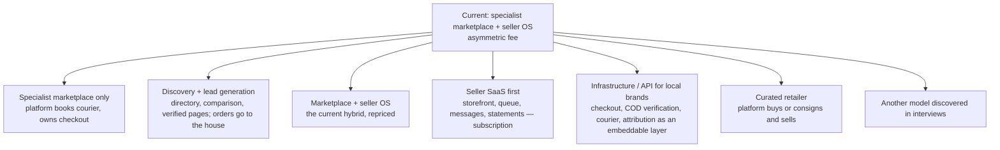
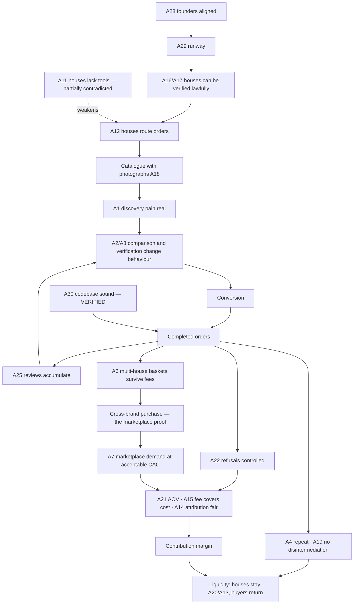

# Founder Red Team Report

**Date:** 18 September 2026. **Premise:** *this company eventually fails.* This report
explains why, before the market does. It reads the six founding documents, the 22
engineering documents, the 70 blueprint documents and the repository as it stands today,
and it does not protect the idea.

**Evidence base verified today (FACT):** working tree at commit `4450d78` plus five
uncommitted files (WORK_PLAN 11.2 wiring); `pnpm -r typecheck` clean across all seven
packages including the uncommitted work; zero `TODO`/`FIXME` markers in source; seed
fixture = three houses, three perfumes, one operator, one delivered order with one review;
no cron, job, or worker configuration anywhere; no git remote; CI file listens on `main`,
branch is `master`. Unit/contract/RLS suite result is recorded in
`MASTER_EXECUTION_PLAN.md` §0.

**Labels:** VERIFIED · PARTIALLY VERIFIED · UNVERIFIED · CONTRADICTED · UNKNOWN. And for
statements: FACT · DOCUMENTED (founding pack) · HYPOTHESIS · RISK.

---

## 0. Where the documentation and the repository disagree (FACT)

| Documentation says | Repository shows | Consequence |
|---|---|---|
| `WORK_PLAN.md` gate table: gate 4 "cancelled, refused, returned, failed-payment reconcile" ✅ | no procedure reaches `cancelled` or `refused`; a refund never transitions the sub-order; the reversal line would violate a trigger | the plan overstates readiness by two gates |
| `README.md`: "seven of eight gates met" | three met, three partial, two not met (`docs/product/01-mvp-readiness.md`) | same |
| `ARCHITECTURE.md` §2 / `TECH_STACK.md` §1: six apps (`web`, `seller`, `admin`, two Expo apps, `jobs`) and `packages/integrations` | one app, no integrations package, no jobs | new sessions will look for folders that do not exist |
| `TECH_STACK.md` §3: Supabase Auth | own OTP + HMAC cookies | ADR-05 records the divergence; the doc has not been corrected |
| `docs/DEBT_REGISTER.md` lists 5 items | the audit found 8 correctness debts and 8 structural debts not in it (`docs/product/03-technical-debt.md`) | "debt outside the register does not exist" is currently false |
| `CLAUDE.md` §13: Redux Toolkit permitted on mobile; `WORK_PLAN` §11–13 builds toward mobile | doc 04 §10 defers native apps to Phase 4; ADR-12 proposes stopping after 11.2 | engineering direction contradicts the founding pack until a founder decides |
| `OPEN_DECISIONS.md`: Phase 0 skip "☐ not recorded" | Phase 1 was built first, 70 commits, zero real orders | the pack's first principle ("evidence before code") was inverted and never acknowledged |
| Blueprint (`docs/`, 18 Sep) | consistent with the repository; it was written from it | none — but it is 70 documents about a company with zero customers, which is itself a finding (§9) |

None of these is hidden; each is stated somewhere. The pattern is that **status
documents are written by the same session that did the work**, and they are optimistic.
The red-team rule: a gate is met when a test named after it passes, not when a screen
exists.

---

## 1. The autopsy — the most likely way this fails

Written as if it happened.

> The founders built a beautiful, well-tested product for a year. Two houses joined
> because the storefront was free and the founders were persistent. Both kept selling on
> WhatsApp the way they always had; the DIYAR link went in the bio and produced a handful
> of orders a month, all from followers the houses already had, all billed at 5 percent.
> The founders spent evenings chasing couriers and typing remittances. Refusals ran at a
> third of dispatches because nobody verified phones. A third house left after a
> statement disagreed with its own cash count. Buyers who came through a house's link
> never browsed another house because a second house meant a second delivery fee, and
> nobody had ever heard of DIYAR outside those two bios. The marketplace rate was never
> charged once. The technical founder, meanwhile, had built the mobile API boundary, a
> CMS with revision history, two themes and a ledger that was correct by then, for a
> business that needed fifteen seller interviews eighteen months earlier. The founders'
> agreement was never signed; when one wanted to stop, the code and the name belonged
> to nobody in particular.

Every sentence above maps to an assumption in §2 that is currently UNVERIFIED or
CONTRADICTED, or to a fact in the repository.

---

## 2. Assumption register

Columns: what · why it matters · evidence for · evidence against · experiment · if false.

### 2.1 Demand side

| ID | Assumption | Class | Why it matters | For | Against | Experiment | If false |
|---|---|---|---|---|---|---|---|
| A1 | Discovery of local perfumes is painful enough to change buying behaviour (doc 01 §2) | **UNVERIFIED** | the whole marketplace half | press lists show fragmented supply; social discovery pages exist (`docs/market/01`) | zero buyer interviews; Instagram + Google + WhatsApp are "good enough" for many purchases; incumbents thrive on "original imported" without local structure | doc 02 §7: 30 recent-buyer interviews asking about the *last* purchase, not preferences | the product is a storefront builder with a directory attached |
| A2 | Buyers value cross-house comparison on structured attributes | **UNVERIFIED** | comparison is the product's differentiator (doc 01 §5) | catalogue schema is the asset (doc 01 §8) | no `comparison_view` has ever fired; buyers of a 300 EGP bottle may decide on smell and price, not longevity bands | interviews; then a compare feature measured against `cart_add` | comparison is a nice-to-have; invest in house pages instead |
| A3 | Buyers distrust individual pages enough to prefer a verified platform | **UNVERIFIED** | "verified" is the promise | COD refusal 20–35 % nationally (cited) suggests low trust in online purchase generally | social sellers sell at volume without any platform; trust attaches to brand and word of mouth | interviews: "why did you trust the seller last time?" (doc 02 §7) | verification is a cost, not a conversion lever |
| A4 | Purchase frequency supports repeat and LTV | **UNKNOWN** | LTV, CAC, cohort economics | doc 01 §4 names "repeat fragrance buyers"; gifting | a bottle lasts months; doc 02 §2 lists "repeat interval" as an open question; 90-day repeat may be structurally low | survey field "purchase frequency"; pilot cohorts | growth must come from acquisition and cross-house, not repeat — CAC must be near zero |
| A5 | The category is large enough | **PARTIALLY VERIFIED** | TAM/SAM | Euromonitor summary: ~19 % value growth 2025, mass most dynamic; Statista ~US$0.87 bn 2025 (cited, secondary) | the *local-house* slice is unquantified; doc 02 §8 bottom-up not done; premium priced above minimum wage | SOM from pilot capacity: active sellers × orders × AOV (doc 02 §8) | a niche business, not a venture-scale one — fine if the founders want that, fatal if they raise on the other story |
| A6 | Customers will accept per-house delivery fees in a multi-house basket | **UNVERIFIED** | cross-brand purchase is the metric that proves the marketplace (doc 02 §11) | doc 06 §6 requires visibility; honest | two houses = two fees (55 EGP each today) on a 600 EGP basket — the model **penalises the behaviour it needs** | `cart_add` multi-house → `checkout_start` drop-off; interview | cross-brand shows up in sequential single orders, not baskets; the metric definition must change |
| A7 | Marketplace-generated demand can be created at acceptable CAC | **UNKNOWN** | the 12–18 % stream | none | no budget (D-9); no campaign has run; competing with incumbents' ad spend | Phase 2 campaigns with attribution; CAC per attributed completed order | the company is seller SaaS with a 5 % fee |
| A8 | Card payment reduces refusals enough to offset PSP fees | **UNVERIFIED** | economics of COD | prepaid fails 5–15 % vs COD 20–35 % (cited, "comparable markets") | Egyptian card penetration; buyers who prefer COD may not switch | Paymob live; refusal by method | COD economics decide viability alone |
| A9 | Arabic-only is sufficient at launch | **PARTIALLY VERIFIED** | scope | market is Arabic; Latin brand names handled | D-3 open; some segments browse in English | interviews | English adds cost later, not risk now |
| A10 | The noir/brass luxury standard fits the value-conscious wedge (doc 01 §4 vs doctrine) | **UNVERIFIED** | conversion; brand | category sells on desire (doctrine) | a Dior-grade aesthetic may signal "expensive" to a buyer of a 290 EGP bottle; the wedge is *affordable* alternatives | show the shopfront in buyer interviews; measure `product_view → cart_add` by price band | the frame must become warmer/more accessible; the doctrine is a preference, not a validated proposition |

### 2.2 Supply side

| ID | Assumption | Class | Why it matters | For | Against | Experiment | If false |
|---|---|---|---|---|---|---|---|
| A11 | Social-first houses lack a capable website/order system (doc 01 §1) | **PARTIALLY CONTRADICTED** | the wedge | doc 01 §2 DM chaos is plausible | cheap storefront builders exist and are used locally (a decant seller runs on `sllr.co`, observed 18 Sep 2026); Shopify/Instagram Shops exist; the missing thing may be *operations and trust*, not a storefront | doc 02 §6: "have you tried a website or marketplace? what happened?" | the pitch must lead with operations, attribution and trust, never with "a storefront" |
| A12 | Houses will route real orders through a third-party link | **UNVERIFIED** | everything | none (rank-2 evidence absent) | routing means moving customers off WhatsApp habits; the house loses the DM relationship feel | 3 houses put the link in the bio and ≥ 50 % of their weekly orders arrive through it within 4 weeks | seller SaaS without routing = a listing site |
| A13 | Houses accept 3–5 % on own customers and 12–18 % on platform-generated | **UNVERIFIED** | the model | generic marketplaces charge 13 % incl. VAT with minimums (Jumia, page-verified) | only houses that already sell on marketplaces have that reference; the asymmetry adds a dispute surface | 15 interviews with an example order (doc 02 §6 q.9) | flat low fee + subscription, or the platform earns nothing on discovery |
| A14 | Attribution can be fair and defensible per order | **UNVERIFIED** | the model's heart | resolver designed; windows snapshotted | capture inert; **structural leaks**: a follower who Googles the house after Instagram arrives as `organic_search` (15 %); a link copied into WhatsApp loses `ref`; multiple houses in one basket | run capture for one month; count disputes; test a "branded search = storefront referral" rule | houses feel taxed → churn; or the platform under-bills by default (today's state) |
| A15 | The low fee covers cost to serve | **CONTRADICTED** | contribution | — | doc 03 §5's own illustration: EGP 2 before failed delivery and fixed cost | interviews on minimum fee / subscription; pilot cost inputs | the SaaS stream needs a fixed component or the marketplace stream must carry everything |
| A16 | Houses can meet verification (identity, product responsibility, labels, EDA-related documentation) | **UNKNOWN** | supply size; legal exposure | checklist designed | perfumed liquids sit under an Egyptian standard regime (cited); small houses may hold no notifications; L7 open | ask 15 houses what documents they hold (doc 02 §6 q.10) | the addressable supply shrinks to formal houses (S2/S3), which want demand the platform cannot yet show |
| A17 | Inspired-by products can be listed lawfully with claim rules | **UNKNOWN** | supply size | claims scanner exists | press shows "inspired" is a major local segment; L8 open; designer references are the likeliest liability | counsel; share of interviewed houses that are inspired-led | excluding them removes much of the wedge; including them without rules is liability |
| A18 | Houses will supply photographs to standard | **UNVERIFIED** | conversion (identical placeholder bottles today) | shoot programme proposed | cost; houses' pride in their own imagery | offer the shoot; measure acceptance | the shelf reads as a template |
| A19 | Houses will not disintermediate after the first order | **UNVERIFIED** | retention | low `direct_repeat` fee; services | the house has the phone after order one; nothing stops a WhatsApp reorder | direct-return metric; "why did you reorder directly?" | the platform is an acquisition channel paid once; fees must reflect that |
| A20 | Seller SaaS is valuable enough to pay for on its own | **UNVERIFIED** | fallback branch (doc 02 §11) | ops pain documented | free tools; WhatsApp habit | interviews: willingness to pay a monthly fee for queue + statements + messages without demand | no SaaS fallback; marketplace or nothing |

### 2.3 Economics and operations

| ID | Assumption | Class | Why it matters | For | Against | Experiment | If false |
|---|---|---|---|---|---|---|---|
| A21 | AOV ≈ EGP 700 (doc 03 §5, illustrative) | **UNKNOWN** | every percentage | — | seeded products 290–450 EGP; press positions local brands as affordable | first 50 completed orders | percentage fees shrink; per-order costs do not |
| A22 | Refusals can be held below the national COD rate | **UNVERIFIED** | largest cost line | verification policy designed (ADR-08) | 20–35 % nationally; `refused` is unreachable today so it cannot even be measured | refusal by house/governorate with reason codes | contribution negative; houses lose stock time; the platform is blamed |
| A23 | Manual operations at pilot scale are feasible for two founders | **PARTIALLY VERIFIED** | pilot | screens exist for queue, moderation, support | no notifications, no exception report, no cancel/refuse; every order needs a founder's eyes; founder time is also the acquisition channel | pilot with a daily checklist and a time log | operations consume the founders; onboarding stops |
| A24 | Cairo/Giza first (D-7) | **ASSUMPTION** | refusal exposure, courier tests | doc 01 §7 | no courier test done; houses may already ship nationally | courier tests; refusal by governorate | — |
| A25 | Verified-purchase reviews will accumulate | **UNVERIFIED** | flywheel asset #2 | gate built | low-frequency category; nobody is asked (no messages) | review request message at +7 days; reviews per earned | quality signals never form; bands stay seller-provided |
| A26 | PDPL compliance is achievable at pilot cost | **UNKNOWN** | licence to operate (~Oct 2026 enforcement, cited) | minimal-data design | executive regulations mention licensing/registration duties (cited commentary); no counsel engaged | counsel (L10–L13) | launch delay or exposure |
| A27 | Fund flow can be handled without holding money (D-5) | **UNKNOWN** | payout model | invoice arrangement possible | PSP settlement for card goes to the platform; counsel/PSP not consulted | PSP + counsel | either invoice-only (COD) or a licensed arrangement |

### 2.4 Team and capital

| ID | Assumption | Class | Why it matters | For | Against | Experiment | If false |
|---|---|---|---|---|---|---|---|
| A28 | Founders are aligned, with agreed equity, time and decision rights | **UNKNOWN** | doc 01 §9 names founder conflict as a strategic risk | doc 05 exists as a checklist | doc 05 is blank; memory notes the owner "felt lost about what remains" (14 Sep) — a sign of asymmetric visibility | complete doc 05 with counsel | the asset (code, name, catalogue) has no clear owner; execution stalls |
| A29 | Runway exists for 6–12 months of pilot and correction | **UNKNOWN** | everything | — | D-9 open; no budget document | a 12-month plan (doc 01 §11) | the pilot is cut short before evidence |
| A30 | The codebase is a sound foundation | **VERIFIED** with a **CONTRADICTED** sub-claim | continue vs rebuild | audit; typecheck clean; ~1,000 tests | the sub-claim "gate 4 met" is false; the money engine has six defects | tests named after gate 4 | the ledger rebuild (planned) — not a rebuild of the product |

**Count:** VERIFIED 1 · PARTIALLY VERIFIED 4 · UNVERIFIED 14 · CONTRADICTED 1 (+1 partial)
· UNKNOWN 9. **Fourteen of thirty assumptions have no evidence at all, and the company has
spent its effort on the one that is verified.**

---

## 3. Stress tests

### 3.1 Marketplace thesis

**Why would customers use this instead of Instagram?** Today: no reason — Instagram has
the house's own voice, photos, DMs and social proof; DIYAR has the same three bottles in
different tints and no reviews. In principle: comparison, verification, honest cost,
tracking, recourse. Those are real only if the buyer has been burned or is choosing
between houses. A first-time buyer who already trusts a house gains almost nothing except
a cleaner checkout. **The honest answer: DIYAR is for the second bottle and the unknown
house, not the first bottle from a known one.**

**Instead of Google?** Google returns the house's site or Instagram, press lists, and
generic marketplaces. DIYAR wins on Google only if house and perfume pages rank for
Arabic queries (server-rendered, structured data — plausible) and answer better (notes,
bands, reviews). This is an SEO race the platform can win slowly and only with content.

**Instead of noon/Jumia/Amazon.eg?** Those win on breadth, logistics, returns and
familiarity. DIYAR wins only where they are weak: local-house identity, structured
scent data, verified makers. If a house is already on Jumia at 13 % with a 10 EGP
minimum (page-verified), DIYAR's marketplace rate must be justified by *better*
customers, not cheaper listing.

**Instead of buying directly from brands?** For a known brand, direct is easier and the
house prefers it. DIYAR's answer is the same low fee on direct repeat plus services;
this only holds if the services are worth the friction.

**Is cross-brand discovery actually valuable?** Unknown, and the delivery model works
against it (A6). The metric that proves the marketplace may be structurally suppressed
by the platform's own honesty about shipping. This is the most important tension in the
thesis and the blueprint underweighted it.

**Is comparison valuable?** For enthusiasts (C3), probably. For the wedge buyer (C1),
unknown. Comparison of longevity bands whose source is "seller-provided" compares
claims, not facts.

**Is there enough purchase frequency?** Structurally low. The category's repeat is
seasonal and gifting; the pack itself lists repeat interval as unknown. LTV will rest on
cross-house and gifting, both unproven.

**Is the category large enough?** Large enough for a real small business; unquantified
for a venture story. Decide which story the founders are telling before D-9.

**Is the marketplace model economically viable?** Not on the low fee alone (doc 03 §5).
Viable only if (a) the marketplace share becomes material at acceptable CAC, or (b) a
fixed fee/subscription exists, or (c) operations revenue (courier, payment
pass-through) exists. None is evidenced.

### 3.2 Seller thesis

**Why would sellers join?** Free storefront, no listing fee, photographs, founder
attention, and the promise of demand. The first three are real; the fourth is not yet.

**Why would they maintain inventory and keep products updated?** Only if orders come
through and stale stock costs them (a refused order for an out-of-stock bottle is a
rejection with a reason code on their record). With no orders, the catalogue rots.

**Why route orders through us?** If the queue, messages and statement save more time
than the link costs them in friction, and if the fee on their own customers is low.
This must be *felt* within the first two weeks or habits win.

**Why not just WhatsApp/Instagram?** Because DM ordering is the pain the pack documents
— but it is a pain houses have survived with, and cheap tools exist (A11). The switching
cost is habit and customer expectation, not technology.

**Why not disintermediate after acquiring customers?** Nothing prevents it. The design
answer (low `direct_repeat` fee) is fair; whether it is enough is unknown (A19). The
platform should assume it is paid once per customer per house and price accordingly.

**Is the seller SaaS valuable independently?** Possibly — it is the doc 02 §11 fallback
— but unproven and competing with free tools and habit. It is the pivot branch most
worth pre-testing in interviews (willingness to pay a monthly fee).

### 3.3 Trust thesis

**Are customers actually lacking trustworthy information?** For unknown houses, yes
(inconsistent descriptions, no recourse). For known houses, no. The trust product sells
*unknown houses to buyers*, which is exactly the marketplace-generated order — so the
trust thesis and the economics thesis are the same bet.

**Which trust problems change behaviour?** Ranked by likely effect (HYPOTHESIS, to test
in interviews): recourse (return/refund route and a platform that answers) > delivery
certainty (dates, fee, COD explanation) > verified maker (who made it, what is in it) >
verified reviews > structured comparison.

**Genuinely useful vs cosmetic:** Useful: delivery-gated reviews, per-shipment cost before
payment, cancel before dispatch, return route, one support route, verification that
actually happened. Cosmetic until proven: the performance-source line (buyers may not
read it), the six-dimension review form (may suppress reviews), the "verified" glyph
without a story behind it.

### 3.4 Economics — dangerous-if-wrong

| Input | If wrong in the bad direction | Danger |
|---|---|---|
| AOV | 300–450 not 700 → percentage revenue halves; per-order costs stay | **high** |
| Seller-originated share | stays ~100 % → revenue ≈ 5 % of GMV; contribution ≈ 0 | **highest** |
| Refusal rate | 30 %+ → courier attempt cost and lost stock time per refusal; cash conversion slows | **highest** |
| Delivery fee per house | customers abandon multi-house baskets → cross-brand metric dies | **high** |
| Payment fees | 2.75 % + EGP 3 (cited) on a 5 % fee order = most of the fee gone | high on seller-originated orders |
| Returns/refunds | opened-perfume returns lawful → cost per return borne by house or platform | medium |
| Support cost | founders' time is free until it is not | medium |
| Promotions | any platform-funded discount on thin margin is a loss per order | high if used |
| Seller acquisition cost | founder hours + shoots per house, recovered only by orders that may not come | high |
| Customer acquisition cost | unknown; incumbents' ad prices | high in Phase 2 |
| Repeat | low → CAC must be near zero | high |
| Cross-brand | suppressed by fees → marketplace proof fails | **highest** |
| Contribution margin | cannot be computed today (A-2) → the company cannot know if any order is profitable | **structural** |

---

## 4. Failure scenarios

Each: root cause · early signal · exposing metric · time to notice · prevention ·
recovery · kill/pivot trigger.

**F1 — Sellers don't route.** Houses join, link stays out of the bio or orders keep
coming by DM. *Signal:* storefront views ≈ 0 for a live house after week 1. *Metric:*
`storefront_referral` orders per house; bio-link check. *Notice:* 1–2 weeks. *Prevent:*
qualify on routing commitment (rank 3 evidence), make the first order effortless, ops
watch. *Recover:* interview; simplify; concierge order entry on their behalf for two
weeks. *Kill/pivot:* < 2 of 5 houses routing ≥ 50 % of weekly orders by week 6 → SaaS-first
or lead-gen branch, or pause.

**F2 — Customers don't convert.** Views without bags. *Signal:* `product_view → cart_add`
far below any reasonable baseline in week 2. *Metric:* stage conversion by entry type.
*Notice:* 2 weeks. *Prevent:* photographs, fee on product page, trust row, COD explanation.
*Recover:* interviews on the exact screen; R1 trust layer. *Trigger:* < 1 % view-to-order
after R1 with ≥ 500 views → thesis A1/A3 failing.

**F3 — Customers only buy from the house that sent them.** *Signal:* zero multi-house
baskets and zero second-house purchases in the first 50 orders. *Metric:* cross-brand
rate; houses viewed per session. *Notice:* 6–8 weeks. *Prevent:* rails, compare, family
browsing; consider house-funded free-delivery thresholds. *Recover:* redefine the metric
(sequential cross-house within 90 days); test consolidated pickup later. *Trigger:*
cross-brand < 5 % of second orders after a quarter → "operate as seller SaaS first" (doc
02 §11).

**F4 — COD refusal too high.** *Signal:* first ten dispatches with ≥ 3 refusals. *Metric:*
refusal by governorate and house with reason codes (requires the refuse path — unbuilt).
*Notice:* immediately once measurable; **today it cannot be measured.** *Prevent:* phone
OTP at first order; ops confirmation calls above a threshold; area policy. *Recover:* card
incentives; stricter policy; drop areas. *Trigger:* > 35 % refusal after verification for
a month → COD-led model unviable in that area.

**F5 — Margins too thin.** Everything at 5 %, payment and support eat it. *Signal:* source
mix 100 % seller-originated after attribution ships. *Metric:* contribution inputs
(needs A-2). *Notice:* end of month 2. *Prevent:* minimum fee modelled before pricing;
pass-through of payment cost. *Recover:* fee model change (D-4) with houses' consent.
*Trigger:* negative contribution per completed order with recorded inputs for two
months → reprice or pivot.

**F6 — Seller churn.** *Signal:* listings not updated, SLA slipping, statement queries.
*Metric:* active houses month over month; retention at 90 days. *Notice:* monthly.
*Prevent:* 14-day review, honest demand expectations, correct statements. *Recover:*
personal contact; fix the cause named. *Trigger:* > 40 % of cohort inactive at 90 days.

**F7 — Disintermediation.** Reorders go to WhatsApp. *Signal:* direct return 0 while houses
report repeat buyers. *Metric:* `direct_repeat` orders vs house-reported reorders
(interview). *Notice:* quarter. *Prevent:* reorder link in the delivered message, low
direct fee, tracking convenience. *Recover:* accept and price as acquisition; CRM with
consent. *Trigger:* houses state > 70 % of repeat happens off-platform.

**F8 — Operational overload.** Founders spend days on couriers and remittances. *Signal:*
daily checklist skipped; exceptions found by customers. *Metric:* founder hours per order
(time log); tickets first-response. *Notice:* weeks. *Prevent:* notifications and SLA jobs
before pilot; cap cohort at 5. *Recover:* pause onboarding; automate the top toil.
*Trigger:* > 30 minutes of founder time per order sustained.

**F9 — Legal/compliance blocker.** EDA documentation excludes most houses (L7); inspired-by
unlawful as marketed (L8); PDPL registration required (L11); fund flow not permitted
(L14). *Signal:* counsel's first answers. *Metric:* share of interviewed houses that can
meet the checklist. *Notice:* 30 days if counsel is engaged now; **never if not.**
*Prevent:* engage counsel before onboarding. *Recover:* narrow category; formal houses
first. *Trigger:* < 30 % of mapped houses can pass verification → supply thesis fails as
defined.

**F10 — Product quality / safety incident.** A rash, a leak, a fake. *Signal:* P0 ticket.
*Metric:* complaints per delivered; safety tickets. *Notice:* days. *Prevent:* product
responsibility control; batch/label evidence; suspension authority. *Recover:* doc 06 §8
safety playbook; suspend; communicate. *Trigger:* any unresolved safety case > 24 h is an
existential trust event.

**F11 — Weak discovery / thin shelf.** Three houses, one per family. *Signal:* search
zero-results; nothing to compare. *Metric:* SKUs per family; houses viewed per session.
*Notice:* immediate. *Prevent:* depth per family in cohort selection. *Recover:* second
cohort focused on families. *Trigger:* cannot reach ≥ 3 houses in ≥ 3 families by month 4.

**F12 — No repeat.** *Signal:* 60-day reorder ≈ 0. *Metric:* 90-day repeat (needs time).
*Notice:* one quarter. *Prevent:* review request and reorder link; house pages as
destinations. *Recover:* gifting and seasonal editorial; accept acquisition economics.
*Trigger:* 90-day repeat < 5 % across two cohorts.

**F13 — Cannot acquire customers economically.** Paid CAC > contribution. *Signal:* first
campaign. *Metric:* CAC per attributed completed order. *Notice:* Phase 2. *Prevent:* no
paid spend before the shelf is deep and reviews exist. *Recover:* stop spend; creators on
performance; SEO. *Trigger:* CAC > 3 × contribution per marketplace order → marketplace
stream is not buyable.

**F14 — Technical complexity as distraction.** *Signal:* commits on mobile boundary,
themes, CMS features while attribution is inert. *Metric:* share of engineering days on
P0/P1 vs other. *Notice:* now — it has already happened (§9). *Prevent:* the execution
plan's gating. *Recover:* ADR-12; freeze non-P0. *Trigger:* any non-gated feature work
before Gate 4.

**F15 — Founder conflict.** *Signal:* doc 05 unsigned; asymmetric visibility. *Metric:*
none — that is the problem. *Notice:* when it is too late. *Prevent:* complete doc 05 with
counsel in the next 30 days. *Recover:* mediator per doc 05 §8. *Trigger:* unsigned by Gate
0 → do not onboard a house that will sign an agreement with an entity that does not exist.

**F16 — Runway.** *Signal:* no budget. *Metric:* months of cash vs plan. *Notice:* now.
*Prevent:* D-9. *Trigger:* < 6 months at Gate 0 → shrink to the SaaS-first or lead-gen
test, which needs less capital.

**F17 — A wrong statement destroys seller trust.** Double payment discovered by a house.
*Signal:* a statement dispute. *Prevent:* **no software payout until the ledger** (kill
switch); manual two-person statements in the pilot. *Trigger:* any payout error reaching
a house.

**F18 — Name fails screening mid-pilot.** Bio links, stationery, shoots branded DIYAR.
*Prevent:* screen now; keep brand assets name-light until cleared. *Trigger:* conflict in
classes 3/35.

**F19 — Vendor dependency.** One courier, one SMS vendor with unknown deliverability
(TECH_STACK §9's own worry). *Prevent:* fallback adapters; manual WhatsApp fallback.
*Trigger:* deliverability < 90 % for a week.

**F20 — Review fraud scandal.** A house posts reviews with its customers' phones.
*Prevent:* phone verification before review; cluster review. *Trigger:* a public
accusation without an audit trail to answer it.

---

## 5. Kill criteria

Objective, measurable, with periods. Thresholds marked (P) are proposals anchored to the
pack (doc 02 §10) or to cited baselines; the founders adopt or adjust them **before** the
pilot, and record them in `DECISION_REGISTER.md` (DR-01). The rule: a criterion met is a
decision meeting, not an argument.

| # | Category | Metric | Threshold (P) | Period | Interpretation | Decision triggered |
|---|---|---|---|---|---|---|
| K1 | Seller adoption | houses routing ≥ 50 % of their weekly orders via the link | < 2 of the first 5 | by pilot week 6 | routing thesis (A12) failing | pivot review: SaaS-first / lead-gen / pause |
| K2 | Completed orders | `earned` sub-orders | < 25 (half of doc 02's 50) | by pilot week 8 | insufficient signal or demand | extend once by 4 weeks with a fix, then pivot review |
| K3 | Conversion | `product_view → order_place` (visitors) | < 1 % after the R1 trust layer with ≥ 500 product visitors | 4 weeks | A1/A3 failing | pivot review |
| K4 | Refusal | refused ÷ dispatched, with phone verification on | > 35 % (above the cited national range) | 4 weeks | COD-led model unviable in that area | area restriction or card-first; if platform-wide, reprice/pivot |
| K5 | Contribution | contribution per completed order with A-2 inputs recorded | negative for 2 consecutive months | 2 months | fee model wrong or costs unbounded | reprice (D-4) with houses; if still negative, pivot |
| K6 | Source mix | marketplace-attributed share of earned orders | < 10 % after the first campaign month (Phase 2) | 1 month | marketplace stream not real | SaaS-first branch |
| K7 | Cross-brand | customers with a second house within 90 days ÷ customers with ≥ 2 orders | < 5 % | one quarter after ≥ 100 customers | marketplace value beyond storefronts absent | SaaS-first / lead-gen |
| K8 | Repeat | 90-day repeat | < 5 % across two cohorts | two quarters | LTV ≈ first order | acquisition-led economics only; reassess |
| K9 | Seller retention | cohort active at 90 days | < 60 % | 90 days | the OS is not valued | interview; SaaS-first test or pause |
| K10 | Customer acquisition | CAC per attributed completed order ÷ contribution per such order | > 3 | first two campaigns | marketplace demand not buyable | stop paid; creators on performance only |
| K11 | Operations | founder minutes per order (time log) | > 30 sustained | 4 weeks | manual model unsustainable | pause onboarding; automate or stop |
| K12 | Legal feasibility | share of interviewed houses able to pass verification; counsel answers on L7/L8/L14 | < 30 % able, or any "not permissible" on L14 without an alternative | Gate 0 | supply or payment model not lawful as designed | redefine category/verification or stop |
| K13 | Capital | months of runway at Gate 0 | < 6 | — | cannot reach evidence | shrink the test (interviews + concierge) or stop |
| K14 | Founders | doc 05 completed and signed | not by Gate 0 | — | no entity to contract | do not onboard houses; resolve or stop |
| K15 | Trust integrity | payout error reaching a house; unresolved safety case | any | — | existential trust event | freeze payouts / suspend; incident review |

---

## 6. Pivot tree

| Branch | Core customer | Problem | Product | Revenue | Required capabilities | Assets that transfer | What changes | Evidence that would justify considering it |
|---|---|---|---|---|---|---|---|---|
| B1 Specialist marketplace only | buyer of unknown houses | trust and comparison | storefronts, compare, reviews, platform-handled delivery and COD | 12–18 % + delivery pass-through | courier account, verification, refusal control, CAC | catalogue, reviews gate, checkout, RLS | platform bears delivery/failed-delivery cost; seller OS becomes minimal | A12 true but A20 false (houses route, do not value tools); A22 controllable |
| B2 Discovery + lead-gen | buyer researching; house wanting leads | discovery, verification without commerce ops | verified directory + comparison + reviews; "order on WhatsApp" links with tracking of clicks | listing/lead fees; sponsored labelled | catalogue, verification, content, click attribution | catalogue, house pages, claims scanner, CMS | drop checkout/orders/payouts; reviews become unverifiable (loses asset #2) | A1/A2 true, A12 false (routing refused), operations overload (K11) |
| B3 Hybrid repriced | same as today | same | same, with minimum fee/subscription and pass-through | fixed + percentage | everything current + ledger | all | fee model (D-4) | A12 true, A15 confirmed (low fee insufficient), A13 accepted with a minimum |
| B4 Seller SaaS first | house owner | DM chaos, cash reconciliation, no statements | storefront + queue + messages + courier + statements; marketplace later | monthly subscription + optional order fee | seller OS polish, WhatsApp integration, courier, reconciliation | portal, queue, SLA clocks, statements, notifications, media | discovery/compare de-prioritised; brand becomes a tool brand; attribution simpler | A12 partially true, A20 true (pay for tools), A2/A7 false (no cross-house, no buyable demand) — doc 02 §11 names this branch |
| B5 Infrastructure/API | house with its own site/Instagram shop | checkout, COD verification, courier, attribution, statements as a service | embeddable checkout + order API + courier + payouts | per-order fee / subscription | HTTP API (exists anonymously), bearer auth, webhooks, developer docs | api, domain, ledger, RLS | no consumer shopfront; B2B sales motion | A11 contradicted strongly (houses have storefronts, lack rails); A12 true via embed |
| B6 Curated retailer | buyer | trust via a single seller of record | platform sells selected perfumes it holds | retail margin | inventory, warehouse, capital, product liability | catalogue, shopfront, reviews | contradicts brand independence (doc 01 §6) and Phase 3 gate; capital-heavy | only if houses cannot fulfil reliably (A22/A23 fail) but buyers want the shelf (A1/A2 true) |
| B7 Discovered | — | — | — | — | — | — | — | interviews reveal a job the pack did not name (e.g., B2B supply to boutiques, gifting, corporate) |

No branch is chosen here. The register (DR-08) asks the founders to pre-agree which
branch each kill criterion points to, so the pivot is a plan, not a panic.

---

## 7. Assumption dependency graph

**Foundational (must be true first):** A28 founders, A29 runway, A16/A17 lawful supply,
A12 routing.
**Bottlenecks:** A12 routing (everything downstream), A6 delivery fees vs baskets (the
marketplace proof), A22 refusals (contribution), A14 attribution (the fee model).
**Downstream:** A4, A19, A25, A7.
**Built on top of unvalidated assumptions today:** the entire shopfront and console
(A1–A3), the mobile boundary (A4, A7 and doc 04 §10), the CMS and two themes (A10), the
six-dimension review form (A25), the attribution resolver's windows (A14), the
noir/brass doctrine (A10). The only verified assumption, A30, sits at the bottom of the
graph and is the one the effort went into.

**Validate first, in this order:** A28/A29 (a week) → A16/A17 (counsel, 30 days) →
A12/A13/A20/A11 (15 seller interviews, 3 weeks) → A1/A3/A10/A6 (30 buyer interviews and
the first 50 orders) → A22/A21/A14 (pilot) → A4/A19/A25/A7 (quarters).

---

## 8. Overbuilding vs underbuilding (repository-specific)

### 8.1 Overbuilt — engineering ahead of evidence (FACT unless noted)

| Item | Evidence | Verdict |
|---|---|---|
| Mobile boundary (11.1 HTTP endpoint, 11.2 durable codes) | built 16 Sep; native apps deferred to Phase 4 by doc 04 | keep (they serve the web) but **stop** the sequence (ADR-12) |
| CMS with typed blocks, revisions, restore, preview, announcements, homepage curation, editorial images | ~20 e2e scenarios; no content editor exists; zero customers | frozen; adequate for years |
| Two themes with contrast proofs, grain, lit flacon rendering, 700 ms reveals | design pass 7 Sep | frozen; the flacon is the placeholder problem, not the solution |
| Audit-log screen with keyset paging | 15 Sep | frozen |
| Owner insights with Cairo-day periods and pre-order funnel | 15–16 Sep | keep; it is the measurement instrument |
| Dependency-advisory hygiene, pnpm overrides with removal conditions | 16 Sep | fine, cheap |
| ~1,000 tests, contract suites on two adapters | — | genuinely valuable; the *cost* is that the same rigour was not applied to the money paths that matter |
| Six-dimension review form that refuses partial submissions | — | may suppress reviews (A25); test a shorter form |
| The 70-document blueprint and this report | — | necessary once; **the next 70 units of effort must be interviews and orders, not documents** |

### 8.2 Underbuilt — more important than the investment suggests

| Item | State | Consequence |
|---|---|---|
| Seller interviews | zero recorded | the routing assumption has no evidence |
| Buyer interviews | zero | A1–A3, A10 untested |
| Counsel engagement | none | L7/L8/L14 could redefine the supply and payment model |
| Founders' agreement, entity, budget | blank | no signatory for a seller agreement |
| Photographs | none real | the shelf is a template |
| Seller agreement | not drafted | cannot onboard |
| SMS adapter | stub | sign-in cannot run in production |
| Notifications | none | every order is silent |
| Deployment | none | no customer can reach it |
| Cancel/refuse paths | unreachable | refusals — the biggest cost — cannot be recorded |
| Attribution capture | inert | the model cannot be tested |
| Payout ledger | double-pays | must not pay anyone |
| Contribution inputs (A-2) | unrecorded | profitability unknowable |
| Ops tooling for exceptions and customer timeline | absent | founders will find problems after customers do |
| Privacy consent records | table unused | PDPL enforcement ~Oct 2026 |
| Multi-house delivery economics | untested; fees per house | the marketplace proof metric may be suppressed by design |

---

## 9. Founder blind spots

Direct, and about the pattern in the repository and documents rather than about people.

1. **Building is the comfortable form of not knowing.** Seventy commits and seventy
   documents exist; fifteen interviews do not. The pack's first principle was inverted
   and the inversion was never recorded (X1). Every week of engineering before the
   routing test is a week of runway spent on the one verified assumption.
2. **Perfectionism at the wrong layer.** "Would Dior ship this screen?" was applied to
   the shopfront while `runPayout` paid twice. The doctrine's standard is admirable;
   the sequencing was wrong. Money correctness is the luxury a marketplace cannot skip.
3. **The wedge and the aesthetic may disagree.** Doc 01 targets value-conscious younger
   buyers of affordable alternatives; the doctrine targets Dior and Xerjoff. Nobody has
   shown the shopfront to a buyer of a 290 EGP bottle. This is a testable question, not a
   matter of taste.
4. **Attribution is treated as solved because it is designed.** The chain-of-responsibility
   resolver is elegant; the leaks (branded search, copied links, multi-house baskets)
   will be felt by houses as taxation. Fairness is a perception houses hold, not a
   property the code has.
5. **Transparency about shipping may kill the metric that proves the marketplace.**
   The pack forbids subsidising multi-house shipping (rightly, for the platform's
   margin) and simultaneously makes cross-brand purchase the proof of marketplace value.
   The founders have not confronted that these pull against each other.
6. **The chicken-and-egg is being solved with code rather than with a founder in a
   room.** The cold-start plan is right (supply first through personal outreach); the
   calendar shows engineering first.
7. **"Manual is fine at pilot" is written by the people who will do the manual work.**
   Two founders, one of whom is the entire engineering team, will also be support,
   courier chasing and reconciliation. No time budget exists (K11).
8. **The founder agreement is treated as paperwork.** Doc 01 §9 calls it the first
   control against the founder-conflict risk. It is blank. Memory records one founder
   feeling lost about status — asymmetric visibility is the precursor.
9. **Legal unknowns are parked as "pending counsel" while onboarding is planned.** If EDA
   documentation excludes most small houses (L7) or inspired-by products cannot be marketed
   as they are (L8), the supply wedge changes. These are Gate 0 questions, not launch-day
   ones.
10. **Premature mobile.** WORK_PLAN 11–13 plans two Expo apps; the pack defers apps until
    retention evidence. The HTTP boundary is a fine by-product; the plan was not.
11. **Premature AI and scaling thinking.** Now documented as gates — good — but the pull
    exists; the register must hold the line.
12. **Underestimating offline operations.** Couriers, cash, photographs, documents,
    training, a house's WhatsApp habits — none of it is in the codebase, all of it decides
    the pilot.
13. **Revenue story ambiguity.** A real small business at the low fee, or a venture-scale
    marketplace at the marketplace rate? The founders should decide which story they are
    telling before setting budget (D-9) and before any investor conversation.

---

## 10. Scenario planning

### Scenario A — Strong validation
*What must have happened:* ≥ 4 of 5 houses route ≥ 50 % of orders; ≥ 50 completed orders
by week 8; refusal under the national range with verification; multi-house baskets
appear despite fees; statements accepted; houses can meet verification; counsel answers
are workable; buyers in interviews name comparison and recourse as reasons.
*Do:* finish the money engine (Phase 3), ship the trust layer, onboard cohort 2 by
family depth, contract Paymob and a courier, start creators on performance.
*Do not build:* apps, warehouse, AI, English, sponsored placement.
*Measure:* source mix after attribution, contribution with recorded inputs, 90-day
repeat, cross-brand rate.
*Next gate:* Gate 5 product-market evidence (one quarter of repeat/direct/cross-brand).

### Scenario B — Mixed validation
*Likely shape:* houses route and value the OS; buyers convert from house links; but
cross-brand ≈ 0, marketplace-attributed ≈ 0, refusals near the national rate,
contribution ≈ 0 at 5 %.
*Do:* reprice toward B3/B4 (minimum fee or subscription) with houses' consent; invest in
refusal control (OTP, card) before discovery; test consolidated delivery for multi-house
baskets on a small scale with measured subsidy; keep the marketplace shopfront but stop
investing in comparison until house count justifies it.
*Do not build:* campaigns, apps, personalisation.
*Measure:* willingness to pay for tools; refusal by method; basket abandonment when a
second house is added.
*Next gate:* a re-scoped Gate 4 in one quarter: either the SaaS economics work or they do
not.

### Scenario C — Weak validation
*Likely shape:* houses join for the free storefront and do not route; or buyers do not
convert even from house links; or refusals exceed the national rate; or counsel finds the
supply cannot be verified as designed.
*Do:* stop building. Run the pivot review with the tree in §6 and the pre-agreed branch
per criterion (DR-08). Interview the houses that did not route and the buyers who did not
convert. If B2 (lead-gen) or B4 (SaaS) shows a signal in interviews, run a four-week
concierge test of that branch before writing code. If nothing shows, pause (doc 02 §11)
and keep the catalogue asset and the codebase for a later attempt.
*Do not build:* anything.
*Measure:* only interview evidence and any residual orders.
*Next gate:* a founder decision within 30 days of Gate 4 with the register in front of
them.

---

## 11. Final strategic verdict

1. **Strongest part of the thesis.** The asymmetric fee tied to attribution, combined
   with verification and delivery-gated reviews — if it works, it is the only model in
   the observed market that aligns a platform with local makers. And a codebase that can
   prove those rules.
2. **Weakest part.** Everything upstream of the first routed order is unverified: that
   houses will route, that buyers cross-shop, that the low fee covers cost, that the
   supply is lawful as imagined.
3. **Single most dangerous assumption.** A12 — houses will route real orders through a
   third-party link — with A6 (multi-house delivery fees suppress the marketplace proof)
   close behind.
4. **Biggest execution risk.** Founder time: two people who are also the engineering
   team, running couriers, cash, photographs and outreach, without an agreement, budget
   or ops lead.
5. **Biggest market risk.** That local houses' customers are satisfied by Instagram +
   WhatsApp + word of mouth, and that "verified" is not the trust word this market buys
   on ("original" is, for imports).
6. **Biggest economic risk.** COD refusals plus per-house delivery fees plus a 5 % fee on
   a 300–450 EGP bottle: negative contribution by design until the mix shifts or the fee
   model changes.
7. **Biggest operational risk.** Silent orders and unrecorded refusals in a pilot with no
   notifications, no exception report and no refuse path.
8. **Biggest technical distraction.** The mobile sequence (11.3–13), followed by any
   further shopfront polish before the trust layer, followed by AI.
9. **Evidence that would make the thesis substantially stronger.** Three houses routing
   most of their weekly orders within a month; buyers naming recourse and comparison
   unprompted; multi-house baskets appearing despite fees; refusals below the national
   range with OTP; statements accepted without a call; counsel confirming the supply can
   be verified as designed.
10. **Evidence that would make us seriously reconsider.** Houses keeping links out of
    bios; buyers converting only from the house that sent them and never browsing;
    refusals at or above the national range despite verification; houses unable to meet
    verification; a fee-model interview where houses reject the asymmetry; founders unable
    to complete doc 05.

**What would have to be true for this company to become a meaningful business?**
Houses route because the operations and fairness are felt within two weeks; buyers of
unknown houses convert because recourse and honest cost are visible; refusals are
controlled below the market's; cross-house behaviour exists in some form the delivery
model does not suppress; the fee model has a fixed component or the marketplace share
becomes material at acceptable CAC; the supply is lawful as verified; and the founders
own the company together on paper.

**What would make me NOT build this?** If, after fifteen seller interviews asking about
last week's real orders, fewer than five houses commit to a dated bio link and a test
order; if counsel says small houses cannot lawfully be listed as designed; if the
founders cannot complete doc 05; or if there is less than six months of runway to reach
fifty completed orders. Under any of those, the right move is the smaller test (B2 or B4
concierge) or a pause — not more code.

**Is it worth continuing to the pilot?** Yes, on one condition that the execution plan
enforces: **no more engineering that is not pilot-minimum or money-correctness until
fifteen houses have been interviewed and counsel has answered the supply questions.**
The product is good enough to test the thesis; the thesis is not yet good enough to
justify the product.
