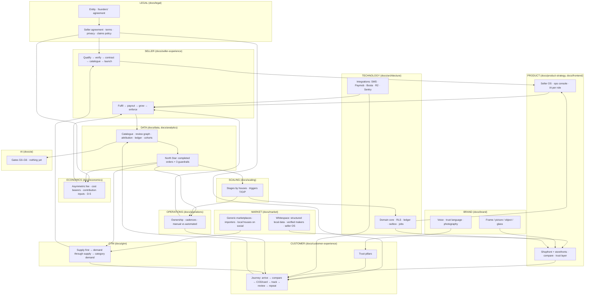

# Project Master Blueprint

**Working name:** DIYAR / ديار (provisional; trademark screening pending — D-1).
**Date:** 18 September 2026. **Status:** strategy and planning only; no code, schema or
production change was made in this phase.

**Labels:** FACT · DOCUMENTED REQUIREMENT · HYPOTHESIS · RECOMMENDATION · ASSUMPTION ·
OPEN DECISION · RISK. Sources: founding docs 01–06; the architecture package
(`docs/architecture/`, `docs/frontend/`, `docs/product/`); the repository; a sourced
market scan (`docs/market/01`).

This document connects the blueprint. Each section points to the documents that carry the
detail.

---

## 1. Executive summary

The company is a **trusted commerce and operating layer for Egyptian local perfume
houses** (doc 01): a specialist marketplace for buyers and an operating system for sellers,
earning a low fee on a house's own customers and a marketplace rate only where it created
the demand (doc 03). The software exists with unusually strong foundations and six
money-path defects that make it unsafe for a real order until fixed (FACT,
`docs/product/01-mvp-readiness.md`). The market context supports testing now — growing
local mass fragrance, social-first discovery, COD dominance with high failure, PDPL
enforcement arriving — but proves nothing about winning (cited, `docs/market/01`). The
founding pack's Phase 0 validation was skipped; this blueprint runs it **on** the product
in the next 90 days (`docs/company/04-90-day-plan.md`) while the money engine is
corrected, and puts every unresolved decision in one register
(`docs/company/03-decision-register.md`).

## 2. Business thesis — `docs/company/02-strategic-thesis.md`

Five claims, all HYPOTHESES: buyers will change behaviour for comparison and verified
trust; serious social-first houses will route real orders if the fee respects their own
demand; the asymmetric fee can be attributed fairly; a completed order can carry positive
contribution without hidden subsidy; the structured catalogue and verified reviews become
an asset nobody else builds. Kill criteria are recorded in advance (doc 02 §11).

## 3. Product thesis — `docs/product-strategy/`

The category is the product: structured scent truth with sources, verified houses,
delivery-gated reviews, honest cost, one relationship — plus a seller OS that is valuable
without marketplace demand. MVP is redefined by outcome: ten completed, attributed,
correctly settled orders across three houses with no database work, including one
cancellation, refusal and return each. Boundaries and non-goals preserved from doc 04 §10.

## 4. Customer thesis — `docs/customer-experience/`

Three personas from the pack (social-first value seeker, gift buyer, repeat enthusiast —
HYPOTHESES). The journey is redesigned around trust at the decision point, cost before
payment, messages at every state, cancel before dispatch, return within policy, review
after delivery, cross-house repeat. Trust is five pillars with evidence behind each
(`03-trust-framework.md`); today most pillars exist in the database and not on screen.

## 5. Seller thesis — `docs/seller-experience/`

Ideal first sellers are social-first microbrands with real weekly demand; verification is
eight controls that cannot be skipped (FACT); the lifecycle is contractual and coded;
success is activation, reliability, correct pay, growth and loyalty; enforcement follows
doc 06 §11. Growth for houses comes from attributed marketplace orders shown per order,
merchandising by indicators, never paid ranking.

## 6. Brand thesis — `docs/brand/`

The platform is the frame, the house is the picture, the product is the object, trust is
the glass. Essence: **considered / مُختار**. Quiet luxury, loud honesty; Arabic-first;
Egyptian and contemporary; no discount voice, no urgency, no superlatives. The identity is
name-independent so it survives D-1. Photography is the identity's largest lever and its
largest current defect.

## 7. Marketplace thesis — `docs/gtm/`, `docs/analytics/05`

Supply first (3–5 verified, photographed houses), demand through supply (their audiences
via attributed links at the low fee), category demand only when the shelf is deep enough
(≥3 houses per family, reviews). Bootstrap with onboarding subsidies that create assets
(photographs, data), never with shipping or discount subsidies (doc 03 §10). Health is
liquidity, balance, source mix, trust and money, with red flags that trigger a founder
review.

## 8. Technology thesis — `docs/architecture/`

Verdict B: continue on a sound modular monolith with a scoped major refactor — rebuild
settlement as an append-only ledger settled once; make every order state reachable; reserve
stock; capture attribution; read rates from the database; add outbox, jobs, notifications,
observability and deployment; keep everything else; stop mobile work (ADR-12). Fifteen
ADRs, five needing founder approval.

## 9. Data thesis — `docs/data/`

Four assets ranked by defensibility: the normalised catalogue, the verified review graph,
the attribution/ledger evidence, cross-house behaviour. Collect structure, not
surveillance; one definition per number; unrecorded is not zero; snapshot what money
depends on. The flywheel is broken today at supply, conversion, reviews and ledger; each
break has a named unblock.

## 10. Operations thesis — `docs/operations/`

The platform owns the customer experience (doc 06). Manual is fine at pilot if the system
records it; money settlement, transitions, stock, attribution, notifications and gates are
never manual at scale; approval, termination, refunds above threshold, review removal and
rate changes are never automated without a person. Cadences: daily checklist, weekly page,
monthly reviews, quarterly gates; hires by trigger, operations before marketing.

## 11. Economics thesis — `docs/economics/`

The asymmetry is the heart and the fragile joint. A 3–5 % fee may not cover payment and
support (doc 03 §5) → model a minimum fee/subscription field before pricing. Failed
delivery is the swing cost (cited 20–35 % COD first-attempt failure) → verification policy,
area policy, card payment as an economic lever. Who holds the cash decides payout
direction (D-5): today the house does, so the platform invoices. No forecasts; a worksheet
with evidence ranks; contribution margin withheld until inputs are recorded (A-2).

## 12. GTM thesis — `docs/gtm/`

Founder-led supply acquisition with the doc 02 §6 interview; a pilot offer of operations,
fairness and photographs; demand from house audiences, editorial and SEO; creators and
campaigns in Phase 2 with attribution and disclosure; never "first in Egypt", never
discount-led.

## 13. Competitive thesis — `docs/market/`

Observed (18 Sep 2026): generic marketplaces with published commissions; imported
"original" e-tailers competing on authenticity and discounts; local houses discovered via
press and social; decant sellers for imported scents; no verified specialist local-perfume
marketplace found (not proof of absence). *Superseded 24 Sep 2026 (P0.4.4):* Perfume Egypt
is one — oud, oils and "alternatives" from "selected Egyptian brands", with seller
onboarding — and Source Beauty carries 15 mapped houses (`docs/market/02` §B, `05`). Whitespace: structured comparable local data,
verified-maker trust, delivery-gated reviews, a seller OS with fair fees, COD done well.
Not a moat: code, name, being first.

## 14. Legal dependencies — `docs/legal/`

Twenty open questions for counsel, accountant, PSP and trademark agent; a dependency map
from entity to advertising disclosure; a policy list in drafting order (founders'
agreement → seller agreement → customer terms/returns/privacy → review/support/COD →
sponsorship). Interim product positions are placeholders or refusals, never assumptions.

## 15. AI strategy — `docs/ai/`

Data before models; structure beats inference; explainable and sourced; humans decide
money, trust and enforcement. Nothing is justified today (three products, zero reviews,
attribution inert). Gates G0–G6 unlock search intelligence, rule-based rails, integrity
flags, similarity within our catalogue, personalisation, forecasting, assistance.

## 16. Scaling strategy — `docs/scaling/`

Stages by houses (0–100, 100–1,000, 1,000–10,000, beyond). Trust operations scale first,
money automation early, integrations when manual dominates, discovery and architecture
last on measured triggers (T1–T10, O1–O6, P1–P4). Extraction by runtime need, never by
domain fashion.

## 17. Defensibility — `docs/market/04`, `docs/data/03`

Catalogue depth, review graph, workflow integration, category reputation, cross-house
relationship — each with the incumbent's likely copy and our answer, and the time each
takes to become real.

## 18. Key risks — `docs/company/01` §Risks, `docs/customer-experience/03` §6

Money engine defects at launch · attribution inert so the model is untestable · borrowed
demand never owned · COD refusal economics · thin margin on seller-originated orders ·
claims and designer-reference liability · PDPL enforcement timing · founder agreement
unsigned · photography absent · name unscreened.

## 19. Major decisions — `docs/company/03-decision-register.md`

Founders must decide: D-8/D-9/D-10 (agreement, budget, entity), D-1 (name screening), X1
(record Phase 0 skip), D-4 (pilot rates with minimum fee), D-5 (invoice arrangement now;
fund holding never without counsel), D-2 (checkout OTP default), D-7 (area), D-6/B-2/B-3
(category), SL-1/SL-4 (suspension orders; reserve and cadence), FD-1..7 (design
direction), ADR-12 (stop mobile), ADR-05 (own identity), ADR-11 vendor cost, GTM-1 shoot
programme, C-1/C-2 cost policies. Legal must decide L1–L20. Technical team decides the
remaining ADRs. Deferred: D-3 English, AI, extractions, apps, warehouse, sampling.

## 20. Dependencies — `docs/company/02-master-dependency-map.md`

Legal → seller agreement → onboarding → catalogue → marketplace → orders → payment and
fulfilment → ledger and reviews → data → analytics → recommendations and growth → supply.
Irreversible: entity/equity, name once filed, published rates and windows, payout
direction, category boundary, published privacy commitments, snapshot semantics,
verified-only reviews.

## 21. 90-day plan — `docs/company/04-90-day-plan.md`

Days 1–30 decide, fix, map · 31–60 onboard, message, first orders · 61–90 measure, settle,
decide (doc 02 §11 gate).

## 22. What NOT to build

Native apps · warehouse · showroom/sampling · AI matching or assistants · designer-name
search or comparison · platform-held balances or split settlement · subsidised shipping ·
open self-approval · sponsored placement before traffic · English locale · loyalty points
· a second BI tool, search service, Redis, broker or microservices · any payout on the
current settlement code.

## 23. What must be proven (evidence, doc 02 §3 ranks)

Houses route live orders and keep the link (rank 2) · buyers complete, repeat and
cross-shop (rank 1) · statements accepted without dispute · refusal rate at or below the
market with verification · a contribution path with recorded inputs · marketplace-attributed
orders exist and houses accept the rate on them.

## 24. What must be true for the company to work

1. Attribution operates and houses believe it.
2. The ledger settles once and both sides can check it.
3. Verification is real and visible.
4. Failed delivery is controlled below the market's rate.
5. The shelf is deep enough per family to compare.
6. Photographs exist.
7. The founders have a signed agreement and an entity.
8. Counsel has answered the claims, returns, payments and PDPL questions.
9. The brand stays quiet under growth pressure.
10. Every number on every screen has one definition.

---

# Final CTO / founder review

**1. What is this company actually becoming?** A category operating system disguised as a
marketplace: the place where Egyptian perfume houses run their orders and are verified,
and where buyers compare them on honest terms. The marketplace stream is the upside; the
seller OS is the floor. If cross-brand behaviour does not appear, it is seller SaaS with a
storefront (doc 02 §11 names this path).

**2. Strongest part of the thesis.** The asymmetric fee tied to attribution — it aligns the
platform with houses in a way flat-commission marketplaces cannot — combined with a
verification and review gate that incumbents would have to restructure to copy. And, in
the repository, a domain core built to make exactly those rules provable.

**3. Most fragile part.** The same asymmetry: it depends on attribution capture that does
not exist yet, on houses accepting a per-order verdict, and on the low fee covering its
cost to serve. And underneath it, a settlement engine that today would pay a house twice.

**4. What must be proven before serious expansion.** Routing (houses keep the link),
completion and repeat, cross-house purchase, statement acceptance, refusal rate under
control, recorded contribution inputs — the doc 02 §10 scorecard with rank-1 evidence.

**5. Decisions dangerous to make too early.** Final rates in signed agreements before
interviews and one attribution cycle; fund holding or split settlement before counsel and
PSP; category boundaries that admit inspired-by products before claim rules; a warehouse;
apps; sponsored placement; English; any AI; the name on stationery before screening.

**6. Decisions dangerous to postpone.** The founders' agreement (doc 01 §9); entity and
counsel engagement; recording the Phase 0 skip; the payout direction (invoice vs pay);
the checkout verification default; stopping mobile work; the photography requirement;
PDPL readiness before ~October 2026.

**7. What should remain manual.** Seller approval and termination; second-person payout
approval; refunds above threshold; review removal; claims judgement; risk decisions on
customers; rate changes; the founders' contact with houses and customers through Stage 0.

**8. What should eventually be automated.** Courier booking and tracking; remittance
matching; payout drafting; exception reports; support routing; catalogue normalisation
assistance; review-integrity flags — each on its trigger (`docs/operations/05`).

**9. The strategic moat.** The normalised catalogue and the verified-delivery review graph,
compounding with the fair-fee relationship houses have no reason to leave.

**10. Not a moat.** The code, the design system, integrations, the name, "first", seed
data, features a generic marketplace ships in a sprint.

**11. Data to accumulate intentionally.** Notes and attributes in a dictionary with
sources; six-dimension reviews tied to deliveries; attribution touches and decisions;
ledger entries with outcomes by reason code; refusal reasons by house and governorate;
cross-house baskets and repeat cohorts; onboarding cost per house; statement disputes.

**12. What the product should become in 12 months.** A reliable operating system for
10–30 houses with photographed, structured catalogues; a shopfront where trust is visible
at every decision point and comparison exists; card payment and a platform courier account
reducing refusals; ledgers and statements nobody disputes; an owner dashboard with a
contribution margin computed from recorded inputs.

**13. What it should not become.** A discount destination; a private-label competitor; a
ranking-for-sale platform; a surveillance data business; a Gulf-styled luxury pastiche; an
app before retention evidence; a warehouse before density.

**14. The company at 100 sellers.** A team of roughly 6–12 (operations, seller success,
finance, content, two or three engineers, growth), operations running on a daily
checklist and exception report, payouts on a fortnightly ledger cycle with two approvers,
Paymob and Bosta integrated, a catalogue deep in a few families, reviews on most tiles,
and a decision on whether the marketplace stream or the SaaS stream is carrying the
economics.

**15. Triggers for the next architectural or organisational stage.** `docs/scaling/04`:
outbox backlog and job volume (worker host); insights load (read replica); search p95 or
zero-result rate (search service); ticket volume (ops lead, support team); onboardings per
month (seller success); payout cycle size (finance); SKU count (category editor); repeat
direct usage (apps); order density (inventory).

**16. Top 10 existential risks.** Founder agreement unsigned · paying houses on a defective
ledger · attribution never operating so the fee model is untestable · COD refusal economics
· thin seller-originated margin · claims/designer-reference liability · PDPL enforcement
non-compliance · houses join but do not route · no photographs, so the shelf reads as a
template · running out of runway before the scorecard (D-9).

**17. Top 10 evidence gaps.** Any real order · seller interviews (15) · buyer interviews
(30) · competitor evidence rows with screenshots · courier COD fees and failed-attempt
charges · PSP terms and fund-holding position · counsel answers on returns, claims,
cosmetics notification, PDPL · refusal rates by area · AOV and source mix · onboarding
cost per house.

**18. Top founder decisions still unresolved.** D-8, D-9, D-10 · D-1 · X1 · D-4 · D-5 ·
D-2 · D-7 · D-6/B-2/B-3 · SL-1/SL-4 · FD-1..7 · ADR-12 · GTM-1 · C-1/C-2.

---

# Master system map

Reading the map: legal enables the seller agreement, which enables onboarding, terms and
economics; brand and market shape the product; the product carries the customer and seller
journeys on the technology; journeys produce data; data produces the North Star and
economics evidence; evidence drives operations, GTM, AI gates and scaling triggers; GTM
feeds supply and demand back into the journeys. Nothing in AI or scaling has an inbound
arrow from anything but data — by design.
