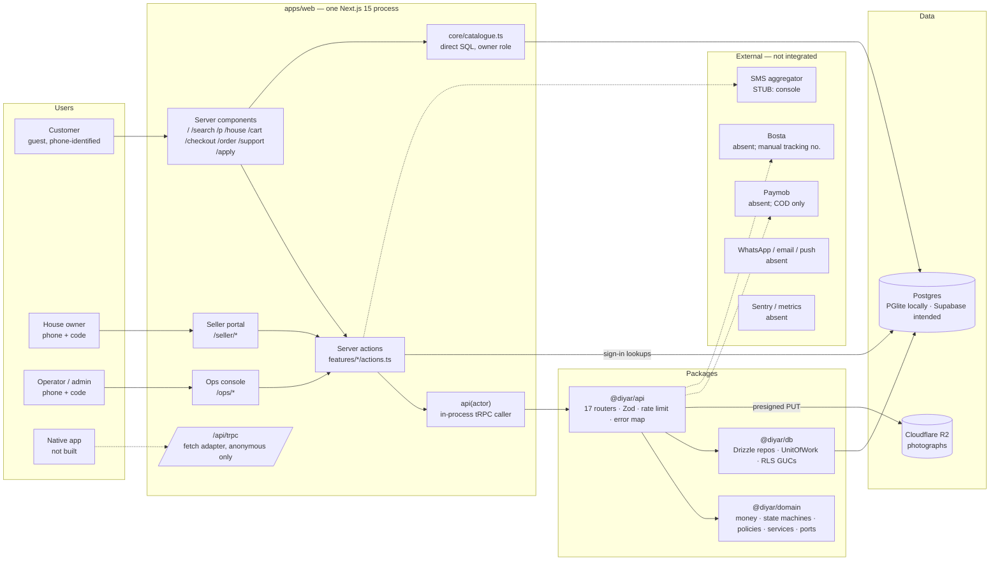
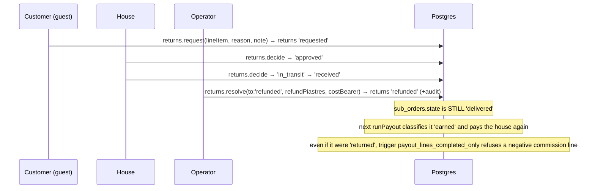

# 01 — Current architecture (as built, 18 September 2026)

This is the system **as it exists**, reverse-engineered from imports, routes, migrations and
tests. Recommendations are in `02` onward; this file only records what is.

Tags: **FACT** observed · **RISK** a way this fails · **REQ** founding-pack requirement.

---

## A. System architecture



**Reading the diagram.** Everything runs in one Next.js process. The web app never uses the
HTTP endpoint; it calls the tRPC router in-process through `api(actor)`. Row-level security
is applied inside `DrizzleUnitOfWork` (GUCs + `SET LOCAL ROLE app_user`). The dotted lines
are integrations that exist as ports or stubs and nothing more. There is no background
process of any kind.

---

## B. Backend architecture

### B.1 Request path (FACT)

```
page.tsx (RSC) ──► features/x/actions.ts ('use server')
                         │  reads cookie → activeSellerSession() / readOpsSession()
                         │  (per-request revalidation against seller_staff / platform_staff — direct SQL)
                         ▼
                   api(actor, sellerId, platform)      ← core/api.ts, the single composition root
                         ▼
                   appRouter.createCaller(ctx)         ← ApiContext: uow + 5 service-role uows + media + clock
                         ▼
                   router procedure (publicProcedure | sellerProcedure | platformProcedure)
                         │  Zod input · rate limit (some) · mapErrors middleware (Arabic)
                         ▼
                   ctx.uow.transaction(async (repos) => { ... domain service ... repos.x.save() })
                         ▼
                   DrizzleUnitOfWork: BEGIN; set_config(actor_role, actor_id); SET LOCAL ROLE app_user; work; COMMIT
```

### B.2 Responsibility placement (FACT)

| Concern | Where | Assessment |
|---|---|---|
| Validation | Zod schemas in `packages/api` (`validation.ts`, per-router) with Arabic messages | correct place |
| Authorisation | tRPC middleware (role) **and** RLS policies (row) **and** DB triggers (state) | defence in depth; correct |
| Business rules | `packages/domain` (state machine, pricing, settlement, attribution, specifications, return policy, review rules, listing gaps, claims) | correct; well tested |
| Orchestration (use-cases) | **inside routers** (`orders.place`, `platform.runPayout`, `returns.resolve`, `seller.dispatch`) — the domain has no application services beyond builders | acceptable at this size, but the routers are where the money defects live (see C.3) |
| Data access | repository implementations in `packages/db`, ports in domain, in-memory double for tests, contract suites run against both | strong |
| Integrations | ports in `packages/api/src/providers` (`OtpSender`, `PaymentGateway`, `CourierPort`, `MediaStore`, `LoginCodeStore`) | ports exist; only media and COD are real |
| Background processing | none | **gap** |
| Error handling | domain errors → tRPC codes → Arabic copy; Zod errors → BAD_REQUEST; unknown → `console.error` + generic Arabic | correct shape, no capture |
| Audit | `AuditTrail` port written inside the deciding transaction for 8 action kinds | strong |
| Cross-cutting (Decorator/Middleware per ENGINEERING_PRINCIPLES §4) | hand-written per procedure (`limit(...)`, `r.audit.record(...)`) | not the registered pattern; easy to forget |

### B.3 Where the layering is breached (FACT, RISK)

1. `apps/web/src/core/catalogue.ts` — 400 lines of Drizzle queries executed as the
   connection owner (RLS not applied). Public reads are safe today only because the queries
   filter `status = 'published'` and `sellers.status = 'live'` by hand.
2. `features/seller/actions.ts` and `features/ops/actions.ts` — identity lookups by direct
   SQL. Understandable (the identity provider is the app), but it means the app owns a
   second data-access path.
3. Server actions are the effective controller layer; there is no `packages/domain/services`
   use-case for "place order", "run payout" or "resolve return" — the sequence lives in the
   router. When a native client arrives it will call the same routers, so this is not a
   duplication risk yet.

---

## C. Frontend architecture

### C.1 Shape (FACT)

- **Server components by default**; `'use client'` islands: `CartStore` (React context over
  localStorage holding `{productId, quantity, seenPrice}`), `CheckoutForm`, `OrderLookup`,
  `ReviewPanel`, `ReturnPanel`, `SupportForm`, `ApplyForm`, `ListingForm`, `PhotoManager`,
  `OrderQueue`, `WorkQueue`, `PageEditor`, `ThemeToggle`, `Track`.
- **Data fetching**: RSC pages call server actions or `core/catalogue.ts`; client islands call
  server actions (`priceCart`, `placeOrder`, `fetchQueue`, …). No client-side tRPC client, no
  TanStack Query, no SWR. Every mutation is a server action round trip followed by a manual
  refetch.
- **State**: URL for search/filters (good); localStorage for the cart; React `useState` for
  forms. No global store.
- **Design system**: `@diyar/tokens` → Tailwind preset exposing **roles only** (`bg-ground`,
  `text-ink`, `text-accent`, …); two themes via `data-theme`; `@diyar/ui` is icons only.
  Shared primitives live in `features/shell` (`PrimaryButton`, `Reveal`, `Grain`, status pill
  helper) and `features/checkout/Field.tsx` — there is **no `design-system/primitives`**
  package as ARCHITECTURE §4 prescribes.
- **Loading/error states**: no `loading.tsx`, no skeletons, no `error.tsx`; client islands
  render "loading" text or nothing while a server action resolves. Forms show Arabic inline
  errors. Empty states exist for cart, search, queue.
- **Auth state**: seller/ops pages read the cookie server-side and render sign-in or the
  screen; no client auth context.
- **Accessibility/RTL**: audited by script at six widths in both themes; logical properties
  only; 44pt targets; focus ring. This is well above typical.

### C.2 Surfaces per role (FACT)

| Role | Surfaces | Composition |
|---|---|---|
| Customer | home (hero + grid), search, product, house, houses, cart, checkout, confirmation/tracking, support, CMS pages, apply | reference-matched dark maison layout; product page 7/5 split at ≥1024 |
| Seller | sign-in, orders queue (cards sorted by deadline), listings list/form/photos, returns, payouts/statement | utilitarian cards, storefront type ramp, capped column |
| Ops | sign-in, work queue, moderation, reviews, returns, support, houses/applications, content list/editor/preview, site, audit, insights | same visual family; tables since 7 Sep; no dedicated tool type scale |

---

## D. Database architecture

Full ER diagram, constraints and indexes: `06-data-architecture.md`. Summary (FACT):

- **36 tables, 26 migrations, forward-only.** Money is integer piastres everywhere; every
  total has a CHECK that it reconciles (`orders_total_reconciles`, `line_items_line_reconciles`,
  `payout_lines_net_reconciles`).
- **State machines in triggers**: sub-order transitions (9 legal pairs), publish gate
  (required fields + verified primary image), seller go-live gate (8 approved controls),
  review-requires-delivery, return-line-belongs, return-money-platform-only, append-only
  audit/transitions/revisions/consents.
- **RLS**: forced on every table; nine actor roles; policies proven by tests running as
  `app_user`. Service roles (`checkout`, `aftercare`, `intake`, `analytics`, `identity`) are
  scoped by `WITH CHECK` so a compromised router still cannot, e.g., create a live seller.
- **Snapshots**: order lines carry product facts and the commission rate/version; sub-orders
  carry the delivery address, delivery arrangement and dispatch SLA hours.
- **Gaps**: no `settled` marker on sub-orders (→ double payout), no `payment` entity (payment
  state is two columns on `orders`), no ledger, no domain-event/outbox table, no
  idempotency-key table, `webhook_events` unused, no down migrations, no soft delete
  (append-only where it matters instead).

---

## E. Critical business flows — as implemented

Each flow: entry → services → data written → external → states → failure points → security
boundary → audit. "—" means none.

| # | Flow | Entry | Services / data | External | States | Failure points (RISK) | Security | Audit |
|---|---|---|---|---|---|---|---|---|
| 1 | Customer registration/login | none — guest only | `customers.findOrCreateByPhone` at checkout | — | — | phone unverified (A8) | `checkout` role | — |
| 2 | Seller onboarding | `/apply` → `applications.submit` | `sellers` (status `applied`), 8 `seller_verifications` seeded by trigger | — | `applied` | rate-limited 3/day/phone | `intake` role, `WITH CHECK status='applied'` | application decisions audited |
| 3 | Seller verification | `/ops/houses` → `applications.verify`, `setStatus` | per-control approve/reject; go-live trigger requires 8 approved | — | `applied→under_review→approved→live→suspended` | no evidence upload; `evidence_ref` is text | platform role | `seller_status_change`, `verification_decision` |
| 4 | Product creation | `/seller/listings/[id]` → `listings.save/submit` | `products` draft, `product_revisions` on change, gap count from `listingGaps` | — | `draft→pending_moderation` | — | seller role, RLS own products | revision rows |
| 5 | Product moderation | `/ops/moderation` → `listings.decide` | `products.status`, coded `moderation_reason`, publish gate trigger | — | `pending_moderation→published / draft (sent back) / suspended` | — | platform | `listing_moderation` |
| 6 | Inventory | `listings.save` (stock, price) | `products.stock` | — | — | **never decremented by an order** (C3) | seller | revision |
| 7 | Browsing | RSC pages → `core/catalogue.ts` | reads only; `analytics_events` insert via `analytics` role | — | — | owner-role SQL (H8) | published/live filters by hand | — |
| 8 | Search/filter | `/search` → `searchCatalogue` | `LIKE` on `search_text` (normalised), enum filters, price, sort | — | — | no index on `search_text`; fine at MVP | anon | — |
| 9 | Product view | `/p/[slug]` | product + media + reviews summary + others | — | — | — | anon | — |
| 10 | Cart | `CartStore` (localStorage) → `cart.price` | server prices from catalogue; adjustments reported | — | — | — | anon | — |
| 11 | Multi-seller cart | same | grouped per house; shipping per house; ETA per house | — | — | flat rate (A1) | — | — |
| 12 | Checkout | `/checkout` → `orders.place` | reprice → customer → terms → `PlaceOrder.build` → `cashOnDelivery.authorise` → `orders`, `sub_orders`, `order_line_items` → transition `placed→awaiting_seller` | none | see 15 | **no idempotency key** (H1); **touches empty** (C4); **no stock decrement** (C3); no notification (H2) | `checkout` role; rate 10/h/phone | — |
| 13 | COD | `cashOnDelivery` gateway | `orders.payment_method='cod'`, `payment_state='pending'` (never advanced) | — | — | payment state never moves; remittance recorded on shipment only | — | — |
| 14 | Electronic payment | — | — | — | — | **not built** | — | — |
| 15 | Order creation | see 12 | one `orders`, N `sub_orders` with snapshots, N transitions | — | `placed→awaiting_seller` | — | — | — |
| 16 | Seller confirmation | `/seller/orders` → `seller.confirm/decline` | transition, `confirmed_at`, `dispatch_due_at` computed; decline requires reason | — | `awaiting_seller→confirmed / rejected` | read-then-write without lock (H13) | seller, RLS own sub-orders | transition row |
| 17 | Dispatch | `seller.dispatch` | `manualCourier.book` (validates format) → `shipments` (cod_amount) + transition | none | `confirmed→dispatched` | tracking number is untrusted text | seller | transition |
| 18 | Delivery | `/ops/queue` → `platform.markDelivered` | transition, `delivered_at` | none (courier webhook absent) | `dispatched→delivered` | operator says so; no proof of delivery | platform | transition |
| 19 | Refusal | — | — | — | `dispatched→refused` **unreachable** (C6) | cost never allocated | — | — |
| 20 | Cancellation | — | — | — | `→cancelled` **unreachable** (C6) | — | — | — |
| 21 | Return | `/order` → `returns.request` → seller `decide` → ops `resolve` | `returns` row through 7 states; cost bearer; refund amount | — | return: `requested→approved→in_transit→received→refunded→closed`; **sub-order stays `delivered`** (C2) | settlement still counts it earned | aftercare / seller / platform | `payout_adjustment` |
| 22 | Refund | `returns.resolve(to:'refunded', refundPiastres)` | `returns.refund_piastres`; **no ledger, no payout line, no payment reversal** (C2) | none | — | money movement exists only in audit JSON | platform | yes |
| 23 | Seller payout | `/ops` → `platform.runPayout(seller, period)` | `listForSettlement` (ALL sub-orders, no period, no settled flag) → `SettlementService.build` → `reconciles` → `payouts` + `payout_lines` | — | payout `accruing` forever | **re-pays every eligible sub-order on every run** (C1); reversal line would violate `payout_lines_completed_only` (C2); no "mark paid" | platform | `payout_approval` |
| 24 | Review | `/order` → `reviews.submit` | trigger + domain + router all require `delivered`; one per line item; masked byline | — | visible / hidden | forgeable if a house knows reference + phone (both visible in its queue) | `aftercare` | moderation audited |
| 25 | Attribution | `AttributionResolver` per sub-order inside `PlaceOrder` | `orders.source`, `line_items.commission_source` | — | — | **no touches captured anywhere** → `unknown` (C4) | — | — |
| 26 | Promotions | — | `orders.discount_piastres` always 0 | — | — | not built | — | — |
| 27 | Admin intervention | ops screens | moderation, status, remittance, payout, refund, content | — | — | no cancel/refuse on behalf of customer; no rate change | platform | mostly audited |
| 28 | Support/exception | `/support` → `support.open`; `/ops/support` → `reply/update` | tickets, messages, priority from category | — | `open→waiting→resolved→closed` | no SLA timers (doc 06 §9 targets), no exception report | aftercare / platform | — |

---

## F. Sequence diagrams — highest-risk flows as implemented

### F.1 Checkout (COD)

```mermaid
sequenceDiagram
  participant B as Browser (CheckoutForm)
  participant SA as placeOrder (server action)
  participant R as orders.place (tRPC)
  participant D as Domain
  participant DB as Postgres (checkout role)

  B->>SA: lines[{productId, qty}], contact, address, 'cod'
  SA->>R: same (no idempotency key)
  R->>R: rate limit 10/h per phone (in-process)
  R->>DB: BEGIN; set actor=checkout; SET ROLE app_user
  R->>DB: snapshotForCart(ids)
  R->>D: CartPricer.price (flat 55/house)
  alt adjustments (price/stock changed)
    R-->>B: CONFLICT "review your bag"
  end
  R->>DB: findOrCreateByPhone(phone)  (no verification)
  R->>DB: listPriorPurchaseSellerIds
  R->>DB: sellers.findById ×N (SLA terms)
  R->>D: PlaceOrder.build(touches: [])  ⇒ every sub-order 'unknown' @ 5%
  R->>D: cashOnDelivery.authorise ⇒ authorised
  R->>DB: INSERT orders, sub_orders ×N, line_items
  R->>DB: applyTransition placed→awaiting_seller ×N
  R->>DB: COMMIT
  R-->>B: reference, total, ETA
  Note over DB: stock untouched · no notification · no attribution touch rows
```

### F.2 Fulfilment to payout (as implemented, showing the double-payment)

```mermaid
sequenceDiagram
  participant H as House
  participant O as Operator
  participant DB as Postgres

  H->>DB: seller.confirm → confirmed, dispatch_due_at = now + sla_hours
  H->>DB: seller.dispatch(tracking) → shipments(cod_amount) + dispatched
  O->>DB: platform.markDelivered → delivered, delivered_at
  O->>DB: platform.recordRemittance(collected) → shipments.cod_remitted_at (+audit)
  Note over DB: after reserveDays the sub-order classifies 'earned'
  O->>DB: platform.runPayout(seller, period A)
  DB-->>O: payout PO-1 with line for sub-order X
  O->>DB: platform.runPayout(seller, period B)   (next week)
  DB-->>O: payout PO-2 with line for sub-order X AGAIN — nothing marks X settled
  Note over DB: payouts.status stays 'accruing'; paid_at never set
```

### F.3 Return and refund (as implemented — the ledger never hears)


