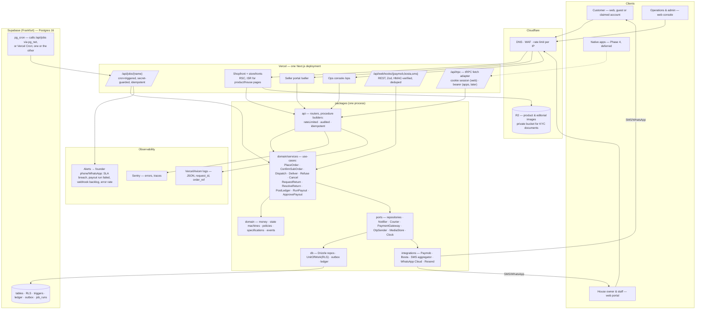

# 02 — Target architecture

Designed from the six founding documents as if starting today, then reconciled with what
exists (see `04-gap-analysis.md`). The target is a **modular monolith**: one deployable web
process, one job-runner entry point, one Postgres, a small set of external adapters. No
microservices, no message broker, no second backend framework.

Tags: **REQ** requirement from docs 01–06 · **REC** recommendation · **ASSUMPTION** ·
**RISK** · **IDEA**.

---

## 1. Target system architecture

**Why this shape (RULE 3, RULE 9).** The business is one team, one country, one product,
with order volumes measured in hundreds per month at pilot. A monolith with hard internal
boundaries (the dependency rule, ports, RLS) gives every benefit of service separation
(testability, replaceable adapters, least privilege) without the cost (network failure
modes, distributed transactions, three deploy pipelines). Service separation becomes
justified only if a component needs a different runtime (e.g. a long-running courier poller)
or a different scaling profile — neither is true before Phase 3.

---

## 2. Target backend architecture

### 2.1 Modules and boundaries

| Module | Owns | Depends on |
|---|---|---|
| `domain/catalogue` | listing lifecycle, vocabularies, claims, completeness, media rules, search normalisation | nothing |
| `domain/orders` | cart pricing, PlaceOrder builder, sub-order state machine, cancellation/refusal policies, stock movement rules | money, clock |
| `domain/money` | `Money`, commission policy, attribution resolver, fee terms, **ledger posting rules**, payout statement builder, reserve/dispute windows | nothing |
| `domain/trust` | reviews, returns, support, seller performance indicators (doc 06 §11) | orders |
| `domain/sellers` | application, verification checklist, staff roles & permissions matrix, suspension effects | nothing |
| `domain/content` | CMS blocks, pages, announcements | nothing |
| `domain/insights` | owner metrics from the ledger, funnel, SLA | money, orders |
| `domain/events` | typed domain events (`SubOrderConfirmed`, `PayoutApproved`, …) and the `EventSink` port | nothing |
| `domain/services` | use-cases (application layer), each taking ports via constructor | all above |
| `api` | tRPC routers (facade), procedure builders, webhook handlers, job handlers, Zod, error map | domain, db types |
| `db` | Drizzle schema, migrations, repositories, `UnitOfWork`, outbox writer, ledger repo, job ledger | domain |
| `integrations` (new package) | Paymob, Bosta, SMS aggregator (+Twilio fallback), WhatsApp Cloud API, Resend; each implements a domain port and declares `isStub` | domain ports |
| `i18n`, `tokens`, `ui` | as today; `ui` grows the primitive set | — |

### 2.2 Use-cases (application services) — the seam routers call

| Use-case | Ports used | Emits |
|---|---|---|
| `PlaceOrder` | products, customers, sellers, orders, stock, attribution, idempotency, payments | `OrderPlaced`, `SubOrderHandedOver` ×N |
| `ConfirmSubOrder` / `DeclineSubOrder` | subOrders (locked), stock | `SubOrderConfirmed` / `SubOrderRejected` |
| `DispatchSubOrder` | subOrders, courier, shipments | `SubOrderDispatched` |
| `RecordDeliveryOutcome` (delivered / refused, from webhook or operator) | subOrders, shipments, payments | `SubOrderDelivered` / `SubOrderRefused` |
| `CancelSubOrder` (customer pre-dispatch, platform any time) | subOrders, stock, payments | `SubOrderCancelled` |
| `RequestReturn` / `DecideReturn` / `ResolveReturn` | returns, subOrders, ledger, payments | `ReturnRequested` … `ReturnRefunded` |
| `ReleaseReserve` (job) | subOrders, payments, ledger | `SaleEarned` |
| `RunPayout` (job or admin) | ledger, payouts, sellers | `PayoutDrafted` |
| `ApprovePayout` / `MarkPayoutPaid` | payouts, audit | `PayoutApproved` / `PayoutPaid` |
| `ChangeCommissionRules` | ruleSets, audit | `CommissionRulesChanged` |
| `DispatchOutbox` (job) | outbox, notifier, analytics | — |
| `WatchSla` (job) | subOrders, notifier | `SlaWarning`, `SlaBreached` |

Rule: a router calls **one** use-case; a use-case runs in **one** `UnitOfWork` transaction;
events go to the **outbox in that transaction**; side effects (SMS, webhooks out) happen only
from the outbox dispatcher. This is the Observer pattern from the registry, made durable.

### 2.3 Repositories

Keep the existing ports. Add `LedgerRepository` (append, listUnsettled, settle),
`StockRepository` (reserve/release/sell with `FOR UPDATE`), `PaymentRepository`,
`IdempotencyRepository`, `OutboxRepository`, `JobRunRepository`, `CommissionRuleRepository`,
`SessionRepository`, `IdentityRepository` (replaces the direct SQL in the web app).

### 2.4 Integrations (Ports & Adapters, contract-tested)

| Port | Adapter | Stub |
|---|---|---|
| `OtpSender` | SMS aggregator (SMSMisr / Victory Link) with Twilio fallback | console (dev only) |
| `Notifier` | SMS (same aggregator), WhatsApp Cloud API templates, email (Resend) | console |
| `PaymentGateway` | Paymob (card, wallet, kiosk) + `cashOnDelivery` | — |
| `CourierPort` (`ShipmentBooking`, `TrackingFeed`, `RateQuote`) | Bosta + `manualCourier` | — |
| `MediaStore` | R2 | local disk |
| `ShippingQuoter` | Bosta tariff by governorate/weight; flat rate until then | — |

### 2.5 Background jobs (Command + retry, idempotent by `job_runs.run_key`)

| Job | Cadence | Does |
|---|---|---|
| `dispatch-outbox` | every minute | reads undispatched outbox rows, fans out to notifier/analytics, marks dispatched, retries with backoff |
| `watch-sla` | every 5 min | warns houses 2h before `confirm_due_at`/`dispatch_due_at`, flags breaches to ops, records `SLA_breach` event |
| `release-reserve` | hourly | delivered + cash in hand + reserve elapsed → ledger `sale_earned` (+commission, +shipping) |
| `run-payouts` | weekly (policy) | drafts one payout per house from unsettled entries; admin approves |
| `poll-courier` | every 15 min (until webhooks) | tracking updates → shipment_events → delivery outcomes |
| `purge` | nightly | analytics events > 180 d, expired login codes, orphan media (DEBT #4/#5) |
| `daily-exception-report` | 06:00 Cairo | unconfirmed, late dispatch, remittance mismatches, failed webhooks → ops + founder (doc 06 §13) |

### 2.6 Event handling

- **Transactional outbox** (06 §2.1). Producers never call adapters.
- Consumers are idempotent (unique `(outbox_id, channel, recipient)` on notifications).
- Inbound webhooks: verify signature → insert `payment_events`/`shipment_events` with
  provider event id (UNIQUE) → run the use-case → 200. A duplicate delivery is a no-op by
  constraint (Idempotent Command from the registry).

---

## 3. Target database architecture

See `06-data-architecture.md` Part 2 for the ER diagram, tables, constraints, indexes,
audit model and the order / payment / payout state models.

## 4. API architecture

See `07-api-architecture.md`.

## 5. Security architecture

See `05-security-architecture.md`.

## 6. Observability

See `09-observability.md`.

## 7. Infrastructure and deployment

See `10-infrastructure.md`.

---

## 8. Marketplace business architecture — the model, explicitly

| Concept | Identity | Owner of truth | Key rules (REQ) |
|---|---|---|---|
| **Customer** | phone (primary), optional claimed account later | platform | one relationship, one support route (doc 01 §6); guest policy D-2 |
| **Seller (house)** | `sellers.id`, slug (storefront) | platform (status), house (profile) | no self-approval; 8 verification controls; SLAs, reserve, fee terms as data |
| **Seller staff** | `seller_staff` with role from S-1 | house owner | permissions matrix (OPEN_DECISIONS S-1); money visible to owner/admin/manager only |
| **Operations / Admin** | `platform_staff.role ∈ {operator, admin}` | platform | admin: rates, payouts, policy; operator: queue, moderation, support |
| **Catalogue / Product** | `products` under a brand under a house | house (facts), platform (moderation) | controlled vocabularies; publish gate; performance source disclosed; prohibited claims |
| **Cart** | browser-held identity + quantity only | server prices | per-house shipping visible before payment |
| **Order** | `DY-` reference, phone | platform | source required; total reconciles; idempotent placement |
| **Sub-order** | `DY-…-A/B/C` per house | house (fulfilment), platform (outcomes) | own state machine and clocks; address snapshot; commission snapshot |
| **Shipment** | tracking number, courier | house or platform (by arrangement) | COD amount; remittance; events |
| **Payment** | one per order | PSP or COD process | state model 06 §2.3; failed payment cancels |
| **Refund** | per return | platform only | reaches ledger and payment |
| **Ledger / Payout** | entries per house; payout per period | finance owner | settled once; two-person approval; statement + dispute deadline |
| **Commission** | rule set version + seller overrides + fee model | both founders | snapshotted at placement; changes audited |
| **Attribution** | touches per visitor → decision per sub-order | platform | windows in the rule set; trail kept; disputes answerable |
| **Promotion** | code / campaign → `discount_piastres`, subsidy bearer | platform or house | never hidden; subsidy is a contribution input (P4) |
| **Review** | one per delivered line item | customer; platform moderates | verified only; no seller deletion; incentives disclosed |
| **Support case** | ticket reference | operations | priority by category, targets doc 06 §9; one timeline across houses |

## 9. What this target deliberately does not include

Native apps · central warehouse · showroom/sampling · AI recommendations · designer-name
search or comparison (legal sign-off first) · platform-held balances or split settlement
before D-5 · a search service · Redis · a message broker · a component kit · a second
backend framework.
