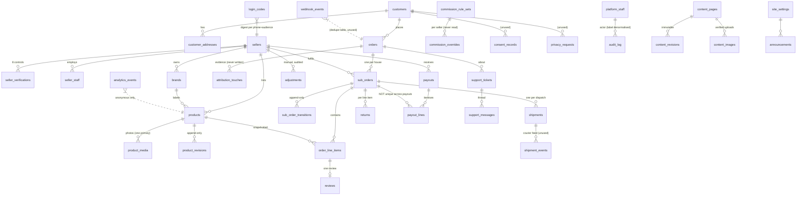
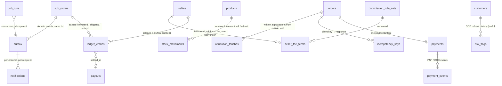
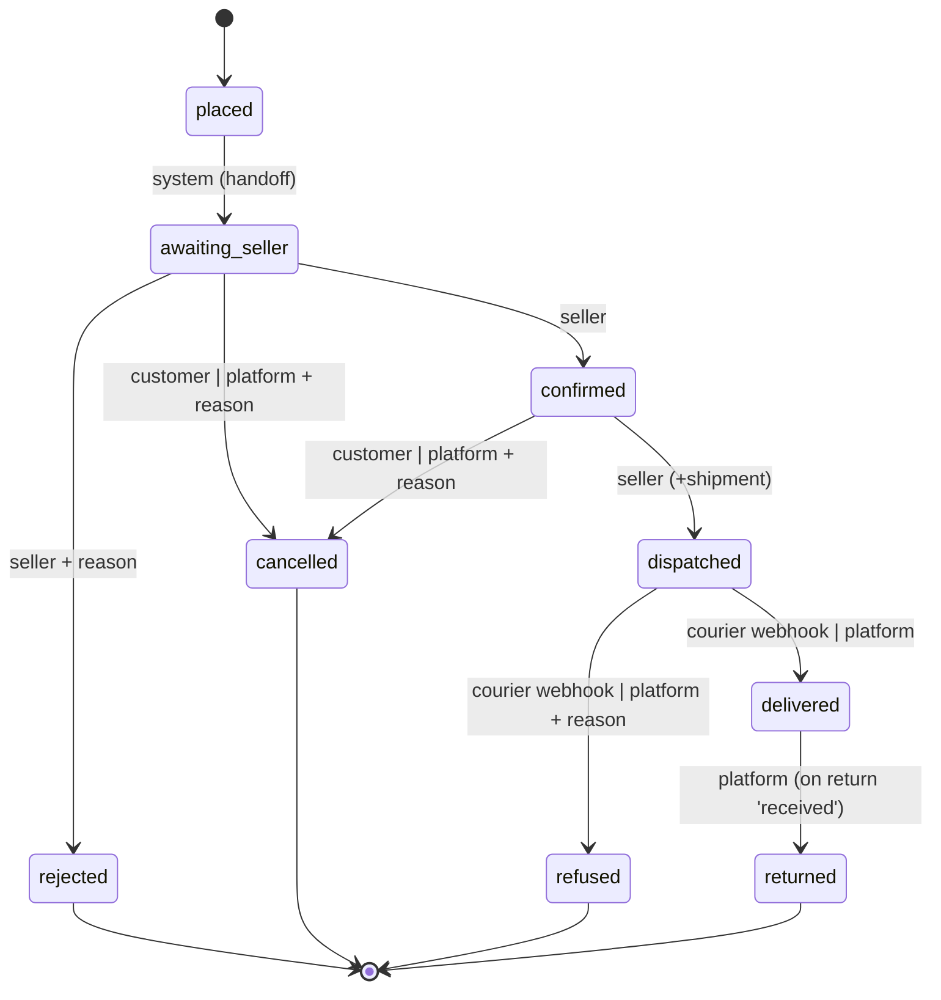

# 06 — Data architecture

Part 1 is the schema **as it exists** (FACT). Part 2 is the **target** (REC): the additions
and changes needed for financial correctness, with the state models the founding pack
requires. Nothing in Part 2 removes an existing table.

---

## Part 1 — Current schema (FACT)

### 1.1 ER diagram

### 1.2 Tables by aggregate

| Aggregate | Tables | Notes |
|---|---|---|
| Identity | `customers` (phone unique, `claimed_at` for future account claim), `customer_addresses` (unused by checkout — address is snapshotted onto the order) | |
| Sellers | `sellers` (status, SLAs, reserve, `delivery_fulfilled_by`), `seller_verifications` (unique seller×control), `seller_staff` (role enum owner/manager/fulfilment/viewer) | go-live trigger |
| Catalogue | `brands`, `products` (24 schema fields + `search_text`), `product_media` (partial unique on `is_primary`), `product_revisions` | publish-gate trigger |
| Orders | `orders` (source NOT NULL, address, money, payment cols), `attribution_touches`, `sub_orders` (state, money, address snapshot, SLA clocks), `sub_order_transitions`, `order_line_items` (commission snapshot) | transition trigger; 0020 dispatch trigger |
| Fulfilment | `shipments` (cod amount/collected/remitted), `shipment_events`, `returns` (status, reason, cost bearer, refund) | return triggers |
| Money | `commission_rule_sets` (two approvers CHECK), `commission_overrides`, `payouts`, `payout_lines`, `adjustments` | net-reconciles CHECK; completed-only trigger |
| Trust | `reviews` (six 1–5 ratings, masked byline, hide), `support_tickets`, `support_messages` | review trigger |
| Governance | `audit_log` (append-only), `consent_records`, `privacy_requests`, `analytics_events`, `webhook_events`, `platform_staff` | |
| Content | `content_pages`, `content_revisions`, `content_images`, `site_settings`, `announcements` | |
| Identity ops | `login_codes` (no policies; three SECURITY DEFINER functions) | |

### 1.3 Integrity that exists

- CHECKs: positive prices, non-negative stock, order/line/payout arithmetic, bps 0–10000,
  ratings 1–5, phone shape, two approvers on a rule set.
- Triggers: sub-order state machine, publish gate, seller verification gate, review requires
  delivery, return line belongs to sub-order, return money platform-only, commission on
  completed only, append-only tables, dispatch SLA snapshot, verification seeding.
- RLS on every table, forced, nine actor roles, tested.

### 1.4 Integrity that is missing (RISK)

| Gap | Consequence |
|---|---|
| No uniqueness of `payout_lines.sub_order_id` per settlement kind | the same sale is paid on every run |
| No settled marker / ledger | payout is a recomputation, not a record |
| `payout_lines_completed_only` forbids negative commission on `returned` | reversal cannot be written |
| No stock reservation | oversell |
| No idempotency table | duplicate orders on retry |
| `orders.payment_state` never transitions | COD lifecycle invisible on the order |
| `attribution_touches` never written | attribution unprovable |
| No outbox / domain events | notifications and jobs have nothing to consume |
| `seller_staff.role` enum ≠ S-1 decision | permissions cannot be implemented as decided |
| No `job_runs` / scheduler ledger | nothing can run twice safely |
| Indexes: `sub_orders(seller_id, state)`, `(confirm_due_at)` exist; missing `(state, dispatch_due_at)`, `products(status, search_text)` trigram, `orders(contact_phone)` (tracking lookup joins by phone) | slow queue/SLA scans later |

---

## Part 2 — Target data architecture (REC)

Principle: **append-only money, explicit state, idempotent writes.** Every change below is
additive and lands in numbered migrations; existing tables keep their shape.

### 2.1 Additions

| Table | Purpose | Key constraints |
|---|---|---|
| `ledger_entries` | append-only seller ledger: `kind ∈ {sale_earned, sale_reversed, shipping_reimbursed, refund_platform, refund_seller, failed_delivery_charge, adjustment, payout}`, `amount_piastres` signed, `sub_order_id`, `return_id`, `settled_in_payout_id NULL` | **UNIQUE (sub_order_id, kind)** for `sale_earned` and `sale_reversed`; CHECK sign by kind; append-only trigger |
| `payments` | one per order: method, state, provider, provider_ref, amount, `captured_at`, `collected_at` (COD), `remitted_at` | state machine trigger (§2.3) |
| `payment_events` | raw provider/COD events with `provider_event_id` | UNIQUE (provider, provider_event_id) — replaces the unused `webhook_events` for payments |
| `idempotency_keys` | `(scope, key)` → response hash + body, `expires_at` | UNIQUE (scope, key) |
| `stock_movements` | `product_id`, `delta`, `kind ∈ {reserve, release, sell, adjust, return_restock}`, `sub_order_id` | `products.stock` maintained by trigger = SUM; CHECK stock ≥ 0 stays |
| `outbox` | `aggregate`, `aggregate_id`, `event_type`, `payload jsonb`, `occurred_at`, `dispatched_at NULL`, `attempts` | written in the same transaction as the state change |
| `notifications` | `recipient_phone`, `channel`, `template`, `payload`, `state`, `provider_ref`, `error` | UNIQUE (outbox_id, channel, recipient) |
| `job_runs` | `job`, `run_key` (e.g. `payout:seller:period`), `started_at`, `finished_at`, `result` | UNIQUE (job, run_key) — a run can be retried, never duplicated |
| `seller_fee_terms` | `fee_model ∈ {percentage, subscription, hybrid}`, `minimum_fee_piastres`, `rule_set_version`, `effective_from`, `approved_by[]` | two approvers CHECK (doc 04 §9) |
| `risk_flags` | per phone: refused count, last refusal, manual note, reviewer | no automated blocklist (doc 06 §7) |

### 2.2 Order and sub-order state model (unchanged transitions, all reachable)

New: every transition **emits an outbox event** (`SubOrderConfirmed`, `SubOrderDispatched`,
`SubOrderDelivered`, `SubOrderRefused`, `SubOrderReturned`, …) and takes a **row lock**
(`SELECT … FOR UPDATE`) before reading the current state.

### 2.3 Payment state model

```mermaid
stateDiagram-v2
  [*] --> pending
  pending --> authorised: PSP webhook (card/wallet)
  authorised --> captured: PSP capture
  pending --> failed: PSP webhook / timeout
  authorised --> failed
  pending --> collected_on_delivery: COD — courier/ops delivered
  collected_on_delivery --> remitted: courier remittance recorded
  captured --> refunded: refund issued (partial → refund rows)
  remitted --> refunded
  failed --> [*]
  refunded --> [*]
```

`failed` on a card order **cancels** unpaid sub-orders (reason `payment_failed`) — the
"failed-payment reconciles" half of acceptance gate 4.

### 2.4 Payout state model and ledger rule

```mermaid
stateDiagram-v2
  [*] --> draft: run creates statement from UNSETTLED ledger entries
  draft --> pending_review
  pending_review --> approved: admin (2nd person), audited
  approved --> paid: bank/wallet reference recorded, paid_at
  approved --> held: dispute within window
  held --> approved
  pending_review --> void: rejected; entries unsettled again
  paid --> [*]
```

**The ledger rule.** A payout run selects `ledger_entries WHERE seller_id = $1 AND
settled_in_payout_id IS NULL AND occurred_at ≤ period_end AND kind ≠ 'payout'`, sums them,
and sets `settled_in_payout_id` on exactly those rows in the same transaction. Entries are
created by events, not by the run:

| Event | Entries |
|---|---|
| sub-order `delivered` + cash in hand + reserve elapsed (job) | `sale_earned` (+gross), `commission` (−fee), `shipping_reimbursed` (+fee if seller-fulfilled) |
| sub-order `returned` (return `received`) | `sale_reversed` (−gross), `commission_reversed` (+fee) |
| return `refunded`, cost bearer seller | `refund_seller` (−amount) |
| return `refunded`, cost bearer platform | nothing on the seller; `platform_costs` row |
| refused with seller responsibility | `failed_delivery_charge` (−courier fee) once A-2 gives the figure |
| manual adjustment | `adjustment` (±), two-person approval |

Both settlement arrangements (platform pays the house; house is invoiced) are the same
ledger with a different sign on the payout entry — which keeps D-5 a configuration.

### 2.5 Audit model

Keep `audit_log` as is. Add: every ledger entry and every payout state change writes an
audit row in the same transaction; `actor_label` stays denormalised. Add
`audit_log.request_id` for correlation (see `09-observability.md`).

### 2.6 Indexes to add

`sub_orders (state, dispatch_due_at)`, `sub_orders (state, confirm_due_at)`,
`ledger_entries (seller_id) WHERE settled_in_payout_id IS NULL`, `outbox (dispatched_at)
WHERE dispatched_at IS NULL`, `orders (contact_phone, placed_at)`, `products USING gin
(search_text gin_trgm_ops)` when the catalogue exceeds a few thousand rows.

### 2.7 Retention, deletion, history

- Orders, ledger, audit, transitions: never deleted; PDPL delete requests **pseudonymise**
  `customers.phone/full_name` and order contact fields after the retention period counsel
  sets, keeping money rows intact (finance obligation).
- `analytics_events`: 180-day purge (A-1, scheduled by the job runner).
- `login_codes`: purge expired hourly.
- Soft delete is not used; archived listings and hidden reviews are states.

### 2.8 Reporting patterns

Owner report and seller statements read the **ledger**, not the sub-orders, so "completed"
has one definition (`sale_earned` exists). Materialised daily aggregates
(`daily_seller_metrics`) come when `/ops/insights` is measurably slow, not before.
