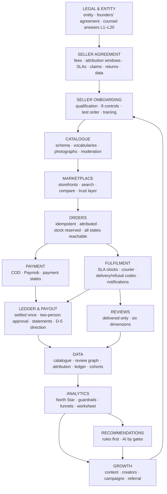
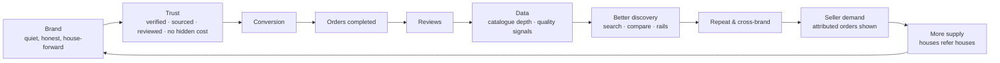

# Master dependency map

One system-level map: what must exist before what, where the bottlenecks are, which
decisions are irreversible, and which can wait.

## 1. The build-and-run chain

## 2. The trust-to-supply loop

## 3. Prerequisites and bottlenecks

| Node | Hard prerequisites | Current bottleneck (FACT) |
|---|---|---|
| Legal & entity | founders' decisions D-8..D-10 | doc 05 blank; no counsel engaged (unknown) |
| Seller agreement | counsel; D-4 rates; D-5 direction | not drafted |
| Onboarding | agreement; evidence storage; photography | evidence as text refs; no shoot budget |
| Catalogue | houses; notes dictionary (later) | three seeded products |
| Marketplace | catalogue depth ≥ 3/family; trust layer | trust signals not on screen |
| Orders | P0 correctness (idempotency, stock, attribution, states) | six defects |
| Payment | D-5; Paymob contract | COD only |
| Fulfilment | SMS adapter; jobs; courier contract | no notifications, no scheduler |
| Ledger & payout | ledger rebuild; second approver; D-5 | double payout |
| Reviews | delivered orders; review request message; phone verification | zero volume |
| Data → analytics | ledger, attribution, cohorts | inputs unrecorded (A-2) |
| Recommendations | AI gates G0–G3 | none met |
| Growth | shelf depth; attribution; budget (D-9) | no budget; no attribution |

## 4. Irreversible or expensive-to-reverse decisions

| Decision | Why hard to reverse |
|---|---|
| Entity and founders' equity/vesting (D-8, D-10) | legal and tax structure |
| The name once filed and printed (D-1) | trademark, domain, houses' bio links |
| Publishing rates and windows in signed seller agreements (D-4) | renegotiation with every house |
| Payout direction and fund-holding posture (D-5) | contracts, PSP, accounting |
| Category boundary (D-6, B-2, B-3) | catalogue shape, brand positioning |
| Privacy commitments published (retention figures, no third-party trackers) | trust; PDPL |
| Snapshot semantics in the data model (rates, addresses, SLAs) | historical statements |
| Verified-only reviews | cannot later admit unverified reviews without breaking the promise |

## 5. Decisions that can wait (and should)

English locale (D-3) · mobile apps · warehouse · sampling · subscription tier · sponsored
placement · second courier/PSP · search service · read replica · AI features · seller
support inbox (S-1 open question) · loyalty points.

## 6. The critical path to a real pilot

Founders' agreement → counsel engaged on L1–L8, L10, L14 → seller agreement draft → P0
money correctness with gate-4 tests → SMS + notifications + jobs → deployment with
observability → 3–5 houses onboarded with photographs → first completed, attributed,
settled orders → scorecard → decision.
