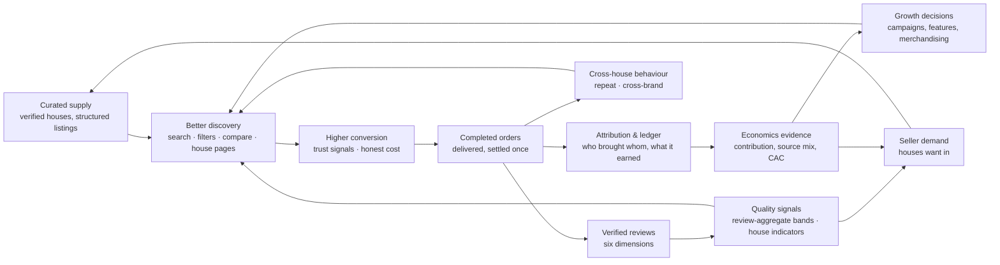

# Data flywheel

Doc 01 §8's growth loop, made explicit with the data each step produces and consumes, and
with the **breaks** — the places where the loop stalls unless a specific thing is true.

## Where the loop breaks today (FACT) and what unblocks it

| Break | Cause | Unblock |
|---|---|---|
| Supply → discovery | three seeded products; identical placeholder bottles; no notes dictionary | pilot cohort (3–5 houses × 5–20 SKUs), photography programme, notes dictionary |
| Conversion → orders | attribution inert; no notifications; unverified phone | P0 roadmap items 6, 10, 11 |
| Orders → reviews | no message asks; forgery possible | review request message; phone verification |
| Orders → ledger | double payout; refunds invisible | ledger (P0-1, 2) |
| Ledger → economics | payment and courier costs unrecorded (A-2) | cost entry method decided; PSP/courier reports |
| Quality → discovery | no ratings on tiles; no review-aggregate bands | R1 trust layer; band threshold decision |
| Economics → seller demand | no attributed-order proof to show S2 brands | after pilot: source mix per house |

## The two proofs the flywheel must produce in the pilot (doc 02 §10–11)

1. **Cross-brand behaviour exists** (searches or purchases across houses). If not, the
   business is seller SaaS first (doc 02 §11 "operate as seller SaaS first").
2. **Marketplace-attributed orders exist** at a rate houses accept. If not, the 12–18 %
   stream is theoretical and the low fee must carry the company (doc 03 §5 shows it barely
   covers costs).

## What becomes defensible, in order

1. The catalogue (from month one; grows with supply).
2. Verified reviews (from the first hundred deliveries).
3. House indicators (three months of orders).
4. Cross-house preference structure (six months, hundreds of customers).
5. Similarity from *our own* notes dictionary and review language — never from designer
   names (legal).

## What is not defensible

The code (doc 01 §8), the design system, the vendor integrations, the seed catalogue,
scraped data, and any metric nobody defined.
