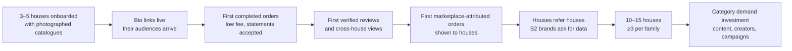

# Cold-start strategy

The chicken-and-egg problem, answered with the pack's own model: **the seller operating
system is the wedge that does not need the marketplace to be valuable.**

## 1. How we create enough supply to attract customers

We do not need much. Three to five houses with 5–20 perfumes each, photographed, described
in the schema, verified — a shelf a first-time buyer can compare within. Depth per family
matters more than count (`docs/analytics/05` §1: ≥3 houses per family). Supply is
acquired with an offer that is valuable **without** marketplace demand: storefront, orders,
messages, statements, photographs (`01-gtm-strategy.md` §2).

## 2. How we create enough demand to make sellers care

Each house brings its own audience through its link and pays the low fee for it. That
demand makes the shelf live and produces the first reviews and the first cross-house
visits. Sellers "care" when they see (a) operations that save them time and (b) their
first marketplace-attributed order — a buyer who arrived through another house's link or
a search and bought from them. The product must show that order with its attribution
touch, or the proof does not exist (ADR-07).

## 3. How we bootstrap both sides without unhealthy subsidies (doc 03 §10)

| Do | Don't |
|---|---|
| Subsidise **onboarding** (shoots, founder hours) — a one-off supply CAC that produces a durable asset (photographs, structured data) | Subsidise **shipping** or **discounts** — a per-order loss with no asset (forbidden until measured) |
| Give houses the low fee on their own customers | Give houses zero fee (removes the signal that the platform must be worth something) |
| Feature by indicators | Sell placement before traffic exists |
| Cross-promote houses on each other's pages ("from other houses", family browsing) | Send paid traffic to a thin shelf |

## 4. The cold-start loop, stage by stage

## 5. Failure modes and responses (doc 02 §11 gates)

| Signal | Meaning | Response |
|---|---|---|
| Houses join, keep the link out of the bio | storefront valued, routing not | interview; simplify; if persistent: "operate as seller SaaS first" |
| Orders flow, no cross-house behaviour | SaaS, not marketplace | invest in compare/discovery before campaigns; reassess thesis at 90 days |
| Cross-house behaviour, no marketplace-attributed orders | discovery exists but is not captured | check attribution capture before concluding |
| Refusals high | COD economics broken | phone verification, area policy, card |
| Polite interest, no commitments | pause (doc 02 §11) | do not build more |

## 6. Cold-start timeline (matches `docs/company/04-90-day-plan.md`)

Weeks 1–4: doc 02 §9 sprint on the built product (P0 correctness in parallel). Weeks
5–8: pilot orders, manual courier and remittance, statements. Weeks 9–12: scorecard,
decision gate, second cohort or revise.
