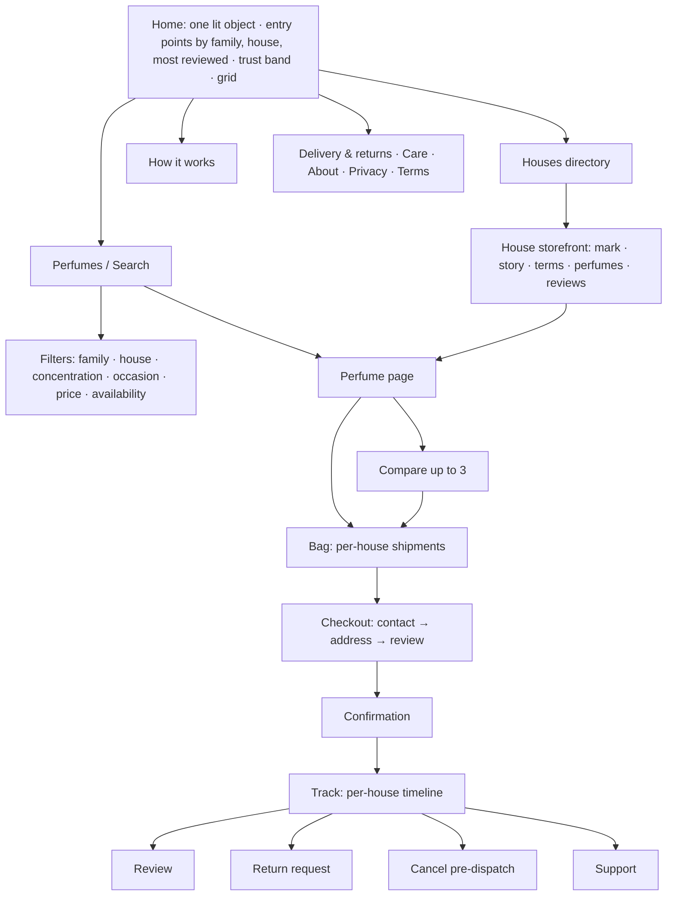
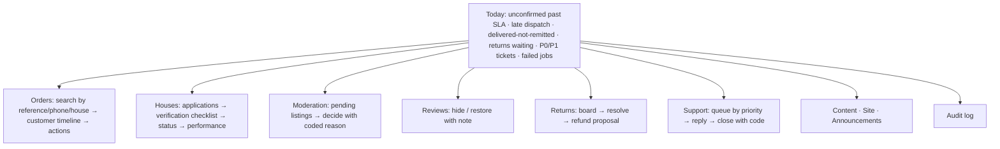
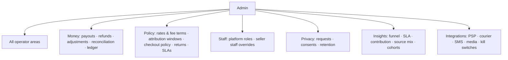

# Information architecture

Designed for six roles (doc 04 §1), independent of the current route tree. Where the current
implementation differs, the difference is noted as FACT so the redesign plan
(`docs/frontend/04-redesign-plan.md`) can be sequenced. Permissions align with
`docs/architecture/05-security-architecture.md` §2.

## 1. Customer

**Primary navigation:** Houses · Perfumes · Search · Bag · (Account/Orders once D-2 allows
claimed accounts; until then "Track an order").
**Secondary:** How it works · Delivery & returns · Care · About · Support · Apply as a house ·
Theme.

**Key objects:** House, Perfume (listing), Review, Bag, Order (with shipments), Return
request, Support case.
**Key actions:** browse by family/occasion/house · search · filter · compare (≤3) · add to
bag · checkout (COD/card) · track · cancel (pre-dispatch) · review (after delivery) ·
request return · contact support · share a house/perfume.



FACT today: no Houses item in the masthead; no compare; no cancel; tracking by reference +
phone only.

## 2. Seller (house owner)

**Primary:** Dashboard · Orders · Perfumes · Returns · Money · House.
**Secondary:** Staff · Notifications · Help/terms · Sign out.

**Key objects:** Sub-order, Shipment, Listing, Photograph, Return, Ledger entry, Statement,
Staff member, House profile.
**Key actions:** confirm/decline/dispatch · edit stock and price · create/submit listing ·
upload photos · answer returns · read statement, dispute · manage staff · edit profile ·
copy storefront link with attribution.

```mermaid
flowchart TB
  D[Dashboard: awaiting · to ship · late · this week · stock warnings · latest statement]
  D --> O[Orders: table by active deadline → confirm / decline reason / dispatch tracking]
  D --> L[Perfumes: list → editor (24 fields, gaps) → photographs → submit]
  D --> R[Returns: requested → agree / decline → received]
  D --> M[Money: ledger → statements → dispute → fee terms & attribution per order]
  D --> HO[House: profile · mark · banner · story · delivery terms · storefront link]
  HO --> ST[Staff: invite · role (S-1) · revoke]
  D --> N[Notifications: SMS/WhatsApp preferences]
```

## 3. Seller staff (S-1 roles)

Same IA, filtered by permission: admin = owner minus ownership transfer; manager = orders,
listings, money (own house); operations = orders, returns, stock; support = read orders,
answer questions (if S-1 grants an inbox — OPEN). Navigation items the role cannot use are
absent, not disabled.

## 4. Marketplace operations (operator)

**Primary:** Today (exceptions) · Orders · Houses · Moderation · Reviews · Returns · Support.
**Secondary:** Content · Site · Audit · Help.

**Key objects:** Order (customer timeline across houses), Sub-order, Shipment, House
application, Verification control, Listing, Review, Return, Ticket, Announcement, Page.
**Key actions:** mark delivered/refused (reason, cost bearer) · cancel on behalf · record
remittance · verify controls · approve/suspend house · moderate listing · hide/restore
review · resolve return (propose refund) · answer ticket · publish content (draft) ·
announce.



FACT today: work queue is limited to delivery confirmation and remittance; no order search
or timeline; no refuse/cancel.

## 5. Admin

Everything an operator has, plus **Money** and **Policy**:

**Money:** payout drafts → approve (second person) → mark paid · refunds approval above
threshold · adjustments · reconciliation (courier statements vs COD amounts) · ledger by
house.
**Policy:** commission rule sets and fee terms (two approvers) · attribution windows ·
checkout policy · return policy values · SLA defaults · staff and roles · privacy requests ·
integrations and kill switches.
**Insights:** funnel, SLA, contribution inputs, source mix, cohort repeat (exists, FACT).



## 6. Content / category management

**Primary:** Vocabularies (read-only view of controlled lists; changes are migrations) ·
Notes dictionary (canonical note names, Arabic/Latin, synonyms) · Merchandising (curation,
featured, sponsored labels) · Editorial (pages, images, announcements) · Catalogue quality
(duplicates, missing fields, claim flags).

Relationship rule: category management edits *presentation and normalisation*, never a
house's factual claims (doc 06 §4: seller owns factual accuracy). Sponsored placement is a
separate labelled field from organic ranking (doc 03 §2).

## 7. Cross-role relationships

| From | To | Link |
|---|---|---|
| Customer order | Seller sub-orders | one order, N sub-orders, one tracking page |
| Seller statement | Admin payout | ledger entries settled once |
| Operator moderation | Seller listing | coded reason returned to the house |
| Customer review | Operator moderation | hide/restore, never delete |
| Admin policy | Seller money | snapshotted at placement; visible per order |
| Category manager | Customer discovery | vocabularies, notes dictionary, curation |
